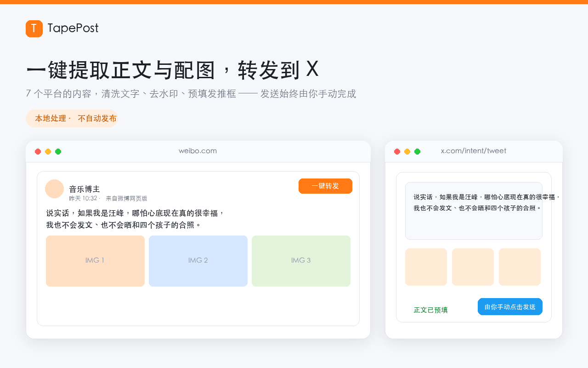

# TapePost信仰者工具

> 在内容页点一下，把正文和配图整理成 X 草稿素材；在 X 上用自选 AI（Grok / xAI API / DeepSeek API）生成评论候选（默认 5 条，可设 1~10 条）；用 295 条导航收录清单核验 TapeOut 生态链接。**发送与回复始终由你手动完成，扩展不会替你发帖。**

- 介绍页：<https://kenter1643.github.io/TapePost/>
- 隐私政策：<https://kenter1643.github.io/TapePost/privacy.html>
- 源码：<https://github.com/kenter1643/TapePost>
- 版本：**1.5.22**（本仓库源码）　｜　Chrome Web Store 上架包：`store/TapePost_1.5.22_store.zip`　｜　Manifest V3　｜　Chrome 116+
- **版本规则**：未经明确授权，只在 1.5 系列里顺延补丁号（1.5.3 → 1.5.4 …），**不自行跳 1.6 / 2.0 等大版本**；新增功能一律算补丁，不改动 minor / major 号。



## 它做什么

在微博、知乎、微信公众号、B 站动态、豆瓣广播、小红书、X 的内容右上角注入一个橙色「一键转发」按钮。点击后：

1. **只取这一条**：按正文锚点定位，剥掉昵称、时间、认证标签、话题尾巴等元信息；按钮点击时实时重新解析卡片，避免无限滚动的 DOM 复用导致抓错内容。
2. **取全部配图**：九宫格、多个媒体容器、懒加载属性、CSS 背景图、内联 `pic_infos`、X 的 `name=orig` 原图，最多 9 张；自动排除头像等干扰图。
3. **本地去水印**：逐张用局部对比提取亮笔画 + 全图重叠瓦片扫描定位任意位置的水印条带（含拼接长图中间、多帧重复），只重建条带内的水印像素（含半透明抗锯齿边缘），用周围真实纹理加权填充；没检测到的图像素一个字节都不改，不会强行抹图。
4. **多图托盘**：右下角弹出「干净图 N 张」，点缩略图可全屏放大浏览（左右切换 / 1:1 原图 / ESC 关闭），可逐张复制、拼长图、下载到临时目录；托盘就绪后再点按钮打开 X，避免 X 抢焦点。
5. **文字预填**：清洗后的正文通过 `x.com/intent/tweet?text=...` 预填到发推框，你在 X 里粘贴图片、确认内容后**手动点发送**。


> **版本状态（2026-11-15）**：本仓库 `main` 是 **1.5.22**（本次更新见下一节；以下为 1.5.7 及更早的历史记录）。此前 **1.5.4**（**修复**：微博首页带视频的帖子仍然看不到「一键转发」按钮 —— 真机（已登录 weibo.com）确认扩展已加载 v1.5.3、图文帖按钮正常，视频帖的入口被播放器图层 / 微博框架重渲染抹掉，且播放器无障碍文本不断变化让内容指纹抖动；现在视频入口改挂在页面根层的固定悬浮条，按卡片位置跟随，视频卡片内部不再写入任何按钮。仍是纯本机 DOM 注入，不新增权限 / 域名 / 数据接收方）。此前 **1.5.3**（**新增**：AI 回复可选 DeepSeek API 模式 —— 运行模式新增第五种「DeepSeek API」，Key / 模型 / 接口地址独立配置，两个 AI 功能与「测试当前模式」都走 DeepSeek；新增 `api.deepseek.com` 一条主机权限，只在用户主动选择并发起 AI 请求时使用；默认站内直连与既有 xAI 设置一行未动）。此前 **1.5.2**（**修复**：微博首页视频微博与 /tv 视频频道看不到「一键转发」按钮 —— 视频信号识别放宽到播放按钮 / 视频链接 / 播放器容器，找不到锚点时退回卡片本身，卡片选择器覆盖不到的视频单元注入独立悬浮入口「一键转发 + 视频剪辑」，层级提到播放器之上；纯本机 DOM 注入，不新增权限 / 域名 / 数据接收方）。同一个 1.5.2 补丁里还包含（新增视频一键转发工作台：卡片「视频剪辑」快捷入口、1~4 段剪接拼接、逐帧去水印、MP4/WebM 导出；含视频的一键转发不再自动开窗抢焦点；此前按真机反馈修复右下角水印漏检：瓦片贴边扫描 + 自适应行阈值 + 结构校验 + 条带纹理重建；商店上架包 `store/TapePost_1.5.2_store.zip`，`store/listing.json` 已同步；TapeUP 卡片删掉与主值重复的页头美元折算价；此前 1.4.29 多图托盘缩略图可点开大图浏览：左右切换 / 1:1 原图 / ESC 或点空白关闭；此前 1.4.28 按真机反馈重写水印检测：拼接长图中间 / 多帧重复水印也能逐处去掉；此前 1.4.27 把所有图片逐张全图去水印 + 4K 高清输出；此前 1.4.26 行情区压成两行：UP 单行 + ②③ 并排；此前 1.4.25 移除昆哥个人介绍卡与生态面板徽章；此前 1.4.24 把行情区精简为只留数字、去掉来源与版本说明；此前 1.4.23 把 UP 主值改抓 K 线图右侧绿色「当前价标签」那个随成交跳动的动态价，页头三数完整保留；行情区按紧凑版重排，收窄到 330px；此前 1.4.22 把行情面板改版为上中下三块、完整展示全部字段；此前 1.4.21 按真机页面重新校准 TapeUP 内盘价为 `0.0264 BEM/UP · $0.3181 · +19.44%`，BEM 与矿机日产价两项明确标注来自 Firsto；矿机日产价改用 /circuits/other 页顶实时挂单参考价；版本号常驻显示在 TapePost 旁边；AI 评论站内直连提示词对齐 X Viral Monitor 极简模板）；Chrome Web Store 待上架版本为 **1.5.21**（此前首次提交审核的条目是 1.4.2，代码不同但数据流向口径一致）。1.4.18 只改本机提示词构造与回答解析，1.4.19 只改本机 UI 与版本读取；1.4.20 只在**同一个已授权域名** `api-tapeout.firsto.ai` 上换了一个公开只读接口路径（`/v1/analytics/circuits` → `/v1/circuit-holders`），并把矿机卡跳转改到 `tapeout.firsto.ai/circuits/other`（普通网页跳转，不需要新权限），不新增域名、权限或网络接收方。`docs/privacy.html` 已同步 1.4.13 的两个只读行情域名、`alarms` / `notifications` 权限与本地阈值存储说明；1.4.14 / 1.4.15 只改本机签名构造与响应解析，不新增网络请求或权限。1.4.16 把行情源换成 tapeup.io 内盘价采集：移除 `api.dexscreener.com` 主机权限、新增 `tapeup.io` 主机权限（仅用于在交易页注入内容脚本读取页面显示的内盘价，不发请求、不读页面外数据），属网络请求变更。**1.5.4 已同步** `store/listing.json`（含行情域名、`alarms` / `notifications` 权限理由）与 `docs/privacy.html`，提交前按 `pre_submit_checklist` 核对 Dashboard 表单即可。**1.4.22 只改本机行情面板的布局与文案**（三列 → 上中下三块 + 完整字段 + 可折叠采集明细），不新增数据源、权限、域名或网络接收方。**1.4.23 也只改本机采集与渲染**（新增读取同一页面上已存在的 K 线图例文本 + 收紧布局），不新增数据源、权限、域名或网络接收方。1.5 上架时上述资料已一次性统一，不再需要分版本补件。

### 1.5.22：修复「扫描没扫完就停了」（多信号结束判定）

用户反馈「扫描不对，没扫完就停了」。根因是旧版 `follow-bridge.js` 只凭「本机名单人数连续 4 轮（4 × 1.5 秒 = **6 秒**）没增加」就写 `status='done'` 并立刻给 MAIN world 采集器发 `stop`：X 的分页请求经常要十几秒；全量重扫时 X 返回的又全是已存账号，人数根本不涨，但页面明明还在一页页往下加载 —— 于是名单只抓了一部分就被判「采集完成」。

- **判定改为可测纯函数**：`follow-core.js` 新增 `scanVerdict()`，只有同时满足「已过最短扫描时长（12 秒）」+「距最后一次 X 响应 / 名单新增 / 页面变高静默 ≥ 20 秒」+「连续 8 轮完全静默」+「页面确实滚到底」+「到底且高度稳定 3 轮」+「没有 X 加载指示器」才判完成；加载指示器有 45 秒宽限，常驻也不会卡死。参数放宽：`maxScroll` 200→**600**、`idleRounds` 4→**8**、`maxCaptureMs` 6 分钟→**20 分钟**。
- **响应心跳**：`follow-capture.js` 在「X 有响应但没解析出新用户」时发 `TAPEFOLLOW_PULSE`（只含计数与时间戳，不含响应内容 / 凭证），桥接层据此知道 X 仍在翻页；`TAPEFOLLOW_DATA` 到达也会刷新 `lastResponseAt`。人数不涨不再等于扫完。
- **滚动不打断加载**：`scanGeometry()` 只读页面高度 / 到底状态 / X 的加载指示器；X 正在加载这一页时跳过本轮滚动，超过宽限则恢复，避免每 1.5 秒重复滚到底打断 X 分页。第一轮 tick 只丢弃「早于本轮开始」的旧信号，不再误把启动瞬间到达的响应当作「整轮无数据」。
- **上限绝不冒充完成**：达到滚动 / 时间上限标 `interrupted`，名单完整保留，中文提示点「增量续扫」或面板「开始采集」接着补；整轮一次 X 分页响应都没收到时也标 `interrupted`，提示刷新 X 页面重试，而不是说「采集完成」。浮层进度条只有真正 `done` 才显示 100%。
- **界面说清状态**：浮层与面板显示「X 正在加载下一页 / X 仍在返回数据 / 继续向下滚动 / 确认列表是否已到底」等中文状态；`followCapture.scan` 只写本机诊断字段（最近响应时间、静默轮数、到底状态），不上传。
- **口径不变**：不主动发请求、不重放、不改参数、不读请求头 / Cookie / ct0 / bearer / 签名；名单仍每批实时落盘、只存本机 `chrome.storage.local`。权限仍 9 项 / 34 条、`content_scripts` 仍 3 段、商店包仍 35 文件，不新增域名或第三方接收方。三份隐私政策、上架资料与 Obsidian 教程同步为 1.5.22；线上账本服务不重部署。新增 `test-follow.js` 第 10 节（可控时钟 + 真实桥接源码模拟慢分页 / 全量重扫 / 加载指示器常驻等场景）。

### 1.5.21：X 页面内中文「互关管理 / 扫描」浮层（吸收 Followback Marker 的交互）

用户反馈「Followback Marker · Scan 部分我看全部是英文」「我需要把他继承进来 我的TapePost」。该第三方扩展的 Scan 面板全英文，靠浏览器 UI 语言切换；本版**不复制它的源码、不引入第二套 `fetch` / `XHR` hook**，而是把它好用的页面内交互吸收进 TapePost 自己的架构：

- **页面内全中文浮层**：新增 `follow-overlay.js` / `follow-overlay.css`，由 manifest 第三段静态 `content_scripts`（ISOLATED world，仅匹配 x.com / twitter.com）注入；只在 `/following` 与 `/followers` 路径出现。提供「全量扫描」「增量续扫」「停止」、进度条、本机已存人数（关注中 / 粉丝分列）、收起 / 展开，以及可随时开关的「列表里标红未回关」（关闭即刻清除所有标记）。
- **复用既有链路**：浮层只写 `followCapture`，`follow-bridge.js` 的 `storage.onChanged` 立即启用 MAIN world 被动采集与自动滚动，1.5.20 的「每批实时落盘 / 关闭面板不丢」原样生效；桥接层按 `cap.mode` 决定从列表顶部重扫或从 `followScanAnchor` 记住的位置续扫，并在扫描过程中持续更新锚点。面板的 `startCapture()` 不写 `mode`，原有「继续采集」行为完全不变。
- **行内标红有前提**：只有「关注中」和「粉丝」两个名单都非空的账号才参与判定，粉丝名单为空时**绝不标红**，避免把所有关注误判为未回关；标记只加在 X 自己的 `UserCell` 上，加 `tpf-row-notback` 类与「未回关」小徽标，关闭开关即刻清掉。
- **取关边界不变**：「从当前位置选未回关」只写一次性的 `followSelectionDraft`，把当前可见账号带进独立分析面板的 `state.selected`（等同手动勾选，过期 / 受保护账号不勾选），**仍须点「预演」并「我确认」才执行**；浮层绝不写 `followTask`、不设 `confirmed`、不自动确认 X 弹窗、不调用 X 任何写接口。
- **开页走扩展内部消息**：内容脚本直接 `window.open('chrome-extension://…')` 会被 Chrome 拦，因此 `background.js` 在文件顶部同步注册 `TAPEFOLLOW_OPEN_PANEL`，由后台 `chrome.tabs.create` 打开扩展自带的 `follow.html`；不访问外部网址、不声明 `web_accessible_resources`、不新增权限。
- **口径不变**：不主动发请求、不重放、不改参数、不读取请求头 / Cookie / ct0 / bearer / 签名；名单、锚点、界面开关与待选草稿只存本机 `chrome.storage.local`。权限仍 9 项 / 34 条，`content_scripts` 仍 3 段，不新增域名或第三方接收方；商店包 33 → **35 个文件**（新增 2 个静态脚本 / 样式，随包分发、无远程代码）。三份隐私政策、上架资料与 Obsidian 教程同步为 1.5.21；线上账本服务不重部署。新增 `test-follow.js` 第 9 节浮层离线模拟与静态不变量断言。

### 1.5.20：修复关注名单丢失（实时落盘 / 关闭面板不丢 / 断点续采）

用户反馈「抓取到的数据要实时记录到缓存中，我上次抓取一部分，重新打开粉丝分析就没有了」。根因在 `follow-bridge.js`：收到采集批次时要求 `followCapture.status === 'running'` 且来源等于 `cap.target` 才写 `chrome.storage.local`，采集一旦自动结束、或关掉面板让状态卡住，后续批次就被整批丢弃；面板写 `followData` 时又用打开时的旧快照整体覆盖，会把桥接层刚落盘的人抹掉。

- **实时落盘**：`follow-bridge.js` 每批到达立即 `mergeSnapshot` 并写入本机缓存，与采集状态完全解耦，按当前 X 标签页来源分类；写入前用「storage 最新值 + 内存副本」合并，检查 `chrome.runtime.lastError`，失败保留副本下批补写并把原因写进采集状态；大名单自动裁掉超长简介，避免触及 `storage.local` 配额导致静默失败。
- **卸载不丢尾批**：`follow-capture.js` 在 `pagehide` / `beforeunload` / 切后台时强制 `flush()`；桥接层监听 `storage.onChanged`，面板点「开始采集」后立刻下发启用命令，不用等 1.5 秒滚动 tick，X 页面刷新后也会按已保存状态补发。
- **面板恢复与续采**：`follow.js` 所有写 `followData` 改为「先读最新再合并」（`writeData()`）；重新打开时补全字段，把超过 30 秒没打 tick 的卡住 `running` 标为「已中断」，**名单完整保留**，点「继续采集」从已保存人数往下补。采集区新增「实时保存」提示（已存人数 + 最后写入时间）；`FOLLOW_PING` 回传 `savedCount` / `storageError` / `lastTickAt` 便于诊断。清空本机名单改为覆盖式写入并通知桥接层丢弃内存副本。
- **口径不变**：权限仍 9 项 / 34 条、不新增域名或第三方接收方，名单仍只存本机、不上传；商店包仍 33 文件。三份隐私政策、上架资料与 Obsidian 教程同步为 1.5.20；线上账本服务不重部署。新增 `test-follow.js` 第 8 节「持久化离线模拟」（vm + mock 缓存真实跑桥接与面板源码），专项 **175/175**。

### 1.5.19：新增 X 关注关系分析（未回关统计 / 分类明细 / 限速批量取关）

- **入口**：弹窗品牌标题正下方新增「👥 互关管理」主入口按钮（渐变主 CTA，第一眼可见），打开独立面板 `follow.html`；沿用 1.5.9 / 1.5.10 的运动会计深色风格与设计令牌。
- **采集（只读）**：`follow-capture.js` 在 X 页面 MAIN world 于 `document_start` 注入，轻量包装 `window.fetch` / `XMLHttpRequest`，只在用户点「开始采集」后被动解析 X 客户端自己加载出来的「关注中 / 粉丝」分页响应；`follow-core.js` 用通用用户节点识别提取公开主页资料，不写死 GraphQL 端点名、抗前端改版。**不主动发请求、不重放、不改参数、不读取任何请求头或登录凭证**。`follow-bridge.js` 在 ISOLATED world 把快照写入 `chrome.storage.local`，并只滚动 X 自己的列表页（连续几轮无新增即结束）。
- **分析与分类**：本机做集合运算，五张可点击统计卡（未回关我 / 我未回关 / 互关 / 全部关注 / 全部粉丝）展开明细；未回关名单再按认证账号、大 V、疑似空号、长期不活跃、低回关比与粉丝量区间分类，支持搜索、排序、分页、CSV 导出与白名单保护。
- **批量取关（唯一写操作）**：勾选 →「预演」逐行核对 → 确认 → 在自己的 `/following` 页上按 5~8 秒随机间隔逐个点击该账号那一行的 X 原生「正在关注」按钮（两级回退定位 + 按钮文字校验），单批最多 50 人、白名单 / 认证 / 大 V / 锁推自动跳过（面板层与桥接层各校验一次）、可随时暂停 / 继续 / 停止、连续 3 次定位失败自动停机；**不调用 X 任何私有 / 公开写接口、不 fetch**。面板明确提示 X 对自动化批量操作有风控。
- **口径不变**：名单只存本机、不上传、不发送给任何 AI 服务或第三方；`permissions` 仍 9 项、`host_permissions` 仍 34 条、不新增域名或数据接收方；`scripting` / `activeTab` 用法完全不变，`content_scripts` 由 2 段增至 3 段；商店包由 28 文件增至 **33 文件**（`follow-core.js` / `follow-capture.js` / `follow-bridge.js` / `follow.html` / `follow.js`）。三份隐私政策、上架资料与 Obsidian 教程同步为 1.5.19；线上账本服务不重部署。新增 `test-follow.js` 专项。

### 1.5.18：视频剪辑正文去乱码 + 打卡名片发 X 改带插件商店链接

- **视频正文乱码**：用户反馈「视频剪辑功能，并没有准确获取到微博视频内容的文字内容，获取的是乱码」。微博视频卡片（首页播放器单元、/tv 网格）把正文藏在内联 JSON、播放器无障碍文本、PUA 图标字体、HTML 实体与百分号 / Unicode 转义里，还常见 UTF-8 被按 Latin-1 误解码。本版新增 `decodeCaptionEscapes()` / `repairCaptionMojibake()` / `normalizeCaption()` / `captionScore()` / `captionRoots()` / `resolveVideoCaption()`：先还原转义与编码、剥掉内联 JSON 与 URL、过滤「某某的微博视频」这类泛化标题，再按祖先卡片 → `data-text` → `og:title` 多路径挑分最高的候选。识别不出时工作台不再塞乱码，改给一个可编辑的「发推正文」文本框，点「打开 X 发推」以框内文字为准；含视频的一键转发也用同一解析器纠正。
- **发 X 文案**：按用户要求「卡片发布到 X 的时候，内容最后不要发链接，可以带上 TapePost 的谷歌插件网址」，`vote.js` 的 `tweetText()` 去掉末尾的账本页链接（该地址带 `sharecode` 分享参数，不适合公开广播），改为 `chromewebstore.google.com/search/TapePost`；话语按剩余字符预算收敛，保证这条链接不会被 `postUrl()` 的 260 字符截断。`STORE_URL` 是唯一常量，正式条目 `/detail/<id>` 链接拿到后改一行即可。「🌐 打开全网账本」按钮与账本读写逻辑一字未动。
- **口径不变**：两项都是本机 DOM 解析与文案，不新增权限 / 主机权限 / 域名 / 数据接收方 / 运行时文件：`permissions` 仍 9 项、`host_permissions` 仍 34 条、商店包仍 28 文件；账本接收的四类公开内容不变，只把三份隐私政策里「发 X 预填文案」的口径同步为 1.5.18（不重部署线上账本服务）。
- **自检**：新增 `test-video-caption.js` **58/58**；发 X 文案新增专项断言（不含账本链接 / 不含 sharecode / 含商店链接 / 长话语不截断）；历史回归 `test-harness.js` 仍 **489/532、新增失败 0**。

### 1.5.17：修复 AI 评论回写「重复 2 条 / 不可编辑 / 发出去只有 1 条」

- **问题**：用户反馈「评论回写有个 bug，就是会写进去评论区，是重复的 2 条，并且人工无法修改，但是发出去是正确的一条」。
- **根因**：X 回复框是 Lexical 一类的受控编辑器。`execCommand('insertText')` 会被浏览器原生写进 DOM、又被编辑器 state 记一次，DOM 里同一句出现两遍；发送时 X 读自己的 state（1 份），于是「界面 2 条、发出去 1 条」，而 DOM 与 state 失步后用户打字被 state 覆盖回来，表现成「人工无法修改」。T 按钮的 `applyQuickPromo()` 从 1.4.11 起就有「写后严格校验 + 恢复原文」，但 AI 候选走的 `writeIntoReply()` 只看 `execCommand` 返回值、从不核对最终文本，于是静默报成功、把两份文本和失步状态留在框里。
- **修法**：
  - 新增 `replyPasteReplace()`：优先派发一次合成 `paste` 事件（`DataTransfer` + `ClipboardEvent`），由 X 自己接管、只更新一次 state，DOM 由它渲染，天然只有一份且保持可编辑；若 X 接管但异步渲染，绝不叠加第二次 `execCommand`（那正是双写来源），改为一帧后只读校验。
  - 新增 `replyWriteVerified()`：写入后按「去空白的完整字符序列」严格校验，多一份 / 少半句一律判失败，只恢复原文一次、绝不重试；原文本为空时也写一次空文本把框清空，不留重复文本。恢复仍失败会标 dirty，明确提示刷新回复框。
  - `writeIntoReply()` 增加幂等判断：这条候选已在框里（连点 / X 重渲染 / 编辑器双写）就直接视为已写入，不再追加第二遍；`applyCommentToReply()` 与候选面板按钮各加 busy 锁防连点。
  - 候选面板：写入异常且已恢复原文时**不再另开 intent 预填页**，只复制候选并提示手动粘贴；成功写入的提示改为「可继续手动修改，再点「回复」」。
- **口径不变**：只修本机写入通道与提示文案，**不新增权限 / 主机权限 / 域名 / 数据接收方 / 运行时文件**：`permissions` 仍 9 项、`host_permissions` 仍 34 条、商店包仍 28 文件；AI 请求仍只发送推文正文与提示词，三份隐私政策按惯例不改动、不重部署线上。
- **自检**：新增 `test-comment-write.js` **68/68**（vm 加载 `content.js` 真实写入函数 + 自建 X 编辑器 DOM 桩，覆盖正常写入 / 连点幂等 / DOM 双写 / 粘贴接管 / 异步渲染 / 恢复与 dirty / 富文本保护 / 候选面板点击不另开 intent）；`test-harness.js` 仍 **489/532、与 HEAD 逐行一致、新增失败 0**。

### 1.5.16：TapeUP 网页采集全部下线（不再干扰正常访问）

- **问题**：用户反馈「插件中网页读取的方式已经影响我正常访问 tapeUP」。根因是 1.5.13 / 1.5.14 为读「我的资产」在 tapeup.io **全站注入**内容脚本（每 3 秒扫 DOM、往页面插角标），并每 30 分钟静默创建一个非激活标签访问资产页，容易触发该站 Cloudflare 风控、干扰用户正在看的页面。
- **接口调研结论（实测）**：`tapeup.io` 整站返回 **403（Cloudflare）**、`api.tapeup.io` 返回 502；TapeOut 官方免费的 TapeAPI 3.0.0 公开服务（`api.tapeapi.fun/tapeapi/v1`）只有 8 个 BNB Chain 只读方法 `blockNumber / balance / tokenInfo / tokenBalance / nftOwner / pairPrice / bnbUsd / tapeName`，实测 `assets` / `upBalance` / `pobAssets` / `accountAssets` / `upPrice` 全部返回 `METHOD_NOT_FOUND`；官方资料明确 $UP 是 PoB 全链账本 **Token ID #00001**、不设独立合约地址、不兼容 ERC-20，「初期仅支持通过 tapeup.io 查询资产」。因此「持仓 / 待释放 / 可加速释放 / 估值 / 涨跌」是站内买入预算，**没有任何公开接口可读**，也不能用链上 `balanceOf` 代替。
- **下线范围**：删除 `manifest.json` 里 `tapeup.io` / `*.tapeup.io` 两条 `host_permissions` 与对应 `content_scripts` 段；`background.js` 删除 `TAPEUP_AUTO` 区块（30 分钟 alarm、静默标签、`tuCollect` / `tuFinish` / `tuApplyPayload`）与 `TAPUP_ASSETS` / `TAPUP_ASSETS_SCAN` / `ASSETS_TAPEUP_COLLECT` 消息链路；`popup.html` / `popup.js` 删除「TapeUP · $UP 我的资产」整组、状态标签与立即重采 / 缓存回刷；商店包移除 `tapeup-price.js`。断钱包时仍清掉历史遗留缓存键。
- **结果**：插件**不再在该站注入任何脚本、不再读取任何页面文本、不再定时或静默打开标签**；「我的资产」与 $UP 内盘价停用并在弹窗明确标注。点行情卡片打开交易页仍是用户主动点击的普通网页跳转，不注入、不读取。`host_permissions` **36 → 34 条**、`permissions` 仍 9 项、商店包 **29 → 28 文件**；不新增任何权限、域名或数据接收方。三份隐私政策新增 1.5.16 段如实披露，商店清单的主机访问理由 / 数据使用 / 权限数量同步。
- **自检**：新增 `test-tapeup-removed.js` 下线验收专项；`test-harness.js` 里一条 1.4.16 旧权限断言改为 1.5.16 口径，历史回归仍 **489/532、新增失败 0**。

### 1.5.15：AI 评论按真实供应商显示 + 候选 1~10 条 + 紧凑结果布局

- **问题**：用户反馈「既然我 AI 评论选择的是 deepseek，那么评论的提示和回复结果，应该都是写 deepseek 不应该还是显示 Grok」；同时要求「结果可以选择最多 10 条，默认 5 条候选，位置布局可以重新设计，可以挤一挤」。
- **供应商标签全链路**：`background.js` 新增 `aiProviderLabel(mode)`，结果带 `provider`；`content.js` 新增 `aiModeNow()` / `aiProviderName()` / `aiShortName()` / `isApiAiMode()`，等待浮层、阶段文案、结果头部、徽标、错误短句、手动兜底按钮、弹窗「测试当前模式」与提示词预览都按真实模式显示 DeepSeek API / xAI API / X 站内 Grok；API 模式隐藏「读取 Grok 回答」手动兜底。错误短句用中性的「AI」保持简短并兼容历史断言。
- **候选条数**：`grok.js` 新增 `COMMENT_COUNT_MAX=10` / `COMMENT_COUNT_DEFAULT=5` / `COMMENT_COUNT_LEGACY=3`、`normalizeCommentCount()`、`commentPromptFor(n)`、`applyCommentCount()`；`buildCommentMessages()` / `buildNativeCommentPrompt()` / `buildPageCommentPrompt()` / `parseThreeComments()` / `parsePageAnswer()` 都按 N 条生成与裁剪，未传 count 仍按 3 条兼容旧测试。`getGrokConfig()` 归一化设置，`commentMaxTokens(count)` 放宽输出；`GROK_NATIVE_CALL` / `GROK_PAGE_PREPARE` / `GROK_PAGE_READ` 透传 count，`grok-native.js` 按 `wantedCount` 截取。
- **设置与布局**：`popup.html` 新增「每次生成候选」下拉（1~10，默认 5），`popup.js` 保存 / 读取 / 钳制并在预览头部标注供应商与条数；结果面板头部加同款下拉，改完写 `chrome.storage.sync` 并重新生成；`.wbx-c-grid.dense` 4 条起两列紧凑网格，面板 440px / 82vh，10 条一屏可览。
- **口径不变**：只改本机提示词构造、文案与布局，不新增权限 / 主机权限 / 域名 / 数据接收方 / 运行时文件：**9 项 / 36 条 / 29 文件**；AI 请求内容仍只有推文正文与提示词，第三方接收方不变，三份隐私政策按惯例不改动、不重部署线上。
- **自检**：新增 `test-ai-comments.js` **46/46**（vm 加载真实 `grok.js` / `background.js`，抽取 `content.js` 真实 helper 与面板函数）；Chrome headless 用真实 CSS/DOM 实渲等待浮层、DeepSeek 10 条两列、Grok 3 条单列，均无裁切 / 溢出。

### 1.5.14：TapeUP 资产定时自动采集（不再显示「未采集」）

- **问题**：用户反馈弹窗「TapeUP · $UP 我的资产」六格全是横杠、状态写「未采集」，并指出「应该是定时读资产的时候一起采集的」。1.5.13 只在用户**主动打开** tapeup.io 资产页时才采集，打开弹窗、点刷新、定时轮询都不会触发，所以本机缓存一直是空的。
- **自动触发**：`background.js` 新增 `TAPEUP_AUTO` 区块：30 分钟 `chrome.alarms` 定时（安装 / 启动重注册）、价格轮询联动、打开弹窗（`WALLET_STATUS`）、点刷新资产（`ASSETS_GET`，强制）、点状态标签（`ASSETS_TAPEUP_COLLECT`，强制）都走统一入口 `tuCollect()`；内部有 30 分钟新鲜度节流与「正在采集」90 秒去重，已绑定钱包才会动手。
- **标签生命周期**：已有 `/trade/assets` 标签时只发 `TAPUP_ASSETS_SCAN` 催内容脚本立即重扫，不新开、不导航、不干扰用户；否则静默创建 `active:false` 的后台标签（`?tpauto=1`），成功后自动关闭，25 秒超时或一次性清理 alarm 兜底收标签（防 MV3 service worker 被回收）；用户中途切到该标签就不关。
- **状态机**：`tapeup-price.js` 失败也回传 `probe` 诊断（只有布尔与短文本），后台细分 `collecting / collected / need-wallet / no-fields / timeout / no-wallet`；失败**不覆盖**上次有效缓存，连续失败按 30 → 60 → 120 → 240 分钟降频。弹窗状态标签可点立即重采，`chrome.storage.onChanged` 自动回刷，不用反复开关弹窗。
- **口径不变**：仍只读页面已显示的文本，白名单清洗后只存本机；不读取地址 / 凭据、不调用站内接口、不上传。不新增权限 / 主机权限 / 域名 / 数据接收方 / 运行时文件：**9 项 / 36 条 / 29 文件**。三份隐私政策新增 1.5.14 段如实披露「定时静默打开同一资产页并自动关闭标签」。
- **自检**：新增 `test-tapeup-auto.js` **68/68**（vm 加载真实后台区块，验证 alarm 注册、标签生命周期、状态机、失败降频、不覆盖缓存）；`test-tapeup-assets.js` 同步到 **95/95**。

### 1.5.13：TapeUP「我的资产」接入面板

- **问题与结论**：用户问「凭钱包地址能否读到 `https://tapeup.io/zh/trade/assets` 的我的资产」。实测该站整站 Cloudflare（后台 `fetch` 直接 403 `Just a moment...`），未连接钱包时页面只有「共 0 个代币 / 请先连接钱包」；且「待释放 / 可加速释放」是 PoB 引擎的站内买入预算、不是链上锁仓，标准 `balanceOf` 读不到。所以**只凭地址 + 后台请求读不到全量数据**，必须走页面会话。
- **实现**：沿用 1.4.16 内盘价的老办法。`tapeup-price.js`（已通过 `content_scripts` 注入 `tapeup.io/*` 全部路径）在 `/trade/assets` 页读已渲染的文本，`price.js` 新增 `extractAssets()` 多策略解析：A 中文 / 英文表头后按列顺序取数（支持 `$31.81` / `USD 15.20` / `+19.44%`），B 卡片式「标签 + 邻近数字」兜底；表头整段先剥离，避免「持仓估值24H涨跌幅」里的 24 被当成持仓。认不出的列留空，绝不拿页面无关数字凑数。
- **链路**：`TAPUP_ASSETS` 回传（先 `TAPE_WAKE` 防冷启动丢消息，失败 3 秒后自动重发）→ 后台只接受 tapeup.io 页面来源，经 `TapePrice.cleanAssets()` 白名单清洗（不留地址、不留页面长文本、raw 限 32 字）→ 写 `tapeupAssetsCache` 本机缓存 → `WALLET_STATUS` / `ASSETS_GET` 带出 → 弹窗新增独立「TapeUP · $UP 我的资产」组（持仓 / 待释放 / 可加速释放 / 持仓估值 / 24H 涨跌 / 代币数），标注来源、采集时间与「仅供参考」；30 分钟未刷新标 stale。未连接钱包或空表不覆盖上次有效缓存，断开钱包一并清除。
- **口径**：这组是**页面展示值、不是按地址查的链上余额**，与 BSC / X Layer 两组明确分开；数据只在页面会话内采集、只存本机、不上传、不读取地址或凭据、不向该域发起任何额外请求、不调用站内接口。不新增权限 / 主机权限 / 域名 / 数据接收方 / 运行时文件：permissions 仍 9 项、host_permissions 仍 36 条、商店包仍 29 文件。三份隐私政策新增「1.5.13 TapeUP 我的资产」段落如实披露。
- **顺带修两个既有小问题**：`tapeup-price.js` 里定义了却从未调用的 `ensureProbe()`（1.4.22 起的价格调试角标实际不显示）已补回；`ASSET_HEADERS` 模块级 `g` 正则的 `lastIndex` 未重置，会让第二次采集匹配失败、列数变少，已每次重置。
- **真机校准**：页面左下角有独立资产角标，点开可看命中列数、策略、每列原始片段。因 CF 拦截无法在开发环境直接抓到真实 DOM，首次真机打开资产页请确认角标是否 5/5 命中；若某列认不出，把展开后的文本发回即可按真实版式补一条策略。
- **自检**：新增 `test-tapeup-assets.js`（91/91，vm 加载真实 `tapeup-price.js` + `price.js` 验证解析与消息链路，不进包）。

### 1.5.12：视频逐帧去水印真正生效

- **问题**：用户反馈「视频去水印功能好像没有生效，水印依然存在」。根因是 `video-edit.js` 直接复用了 `inpaint.js` 为静态高清图片（1200×1466 / 648×1920）调的检测阈值（`lumStrong 175` / `deltaStrong 18` / `widthMin 90` / `jumpsConfirm 12` / `strongMin 0.08`），而视频帧被缩到 540~720p、经 H.264 压缩、水印多为半透明且只有十几像素高，检测几乎恒为「未检测到水印」。检测框为空时每一帧都把 `getImageData` 原样 `putImageData` 回去，导出的就是原画面；旧版还只在首帧检测、之后每 90 帧才重检，并且检不出也照样报「生成完成」，用户完全无从判断。
- **视频链路单独调参**：新增 `VIDEO_WM_DEFAULTS`（只作用于视频，图片的 `TILE_DEFAULTS` 一字未动），放宽亮度 / 局部对比 / 最小宽度 / 列跳变 / 笔画密度门槛；片头每 3 帧扫一次避开黑帧与淡入（逐帧全图扫描会把 1080p 实时录制拖慢），之后约每 1 秒重检一次，可跟随移动水印；没命中立刻收手，避免偶然误检持续抹坏画面。
- **手动兜底（关键）**：视频工作台新增「水印位置」区，提供自动检测 / 右上 / 右下 / 左上 / 左下 / 顶部整条 / 底部整条 / 中间预设（可多选），并支持「在预览上拖框」自定义；框以 0~1 归一化坐标随消息传入，导出时按实际画布换算，**每一帧无条件重建**，不依赖检测命中。预览因 CDN 限制加载不出来时预设仍然可用。
- **重建算法**：图片版 `rebuildBand` 是按列取上下参考行插值，在运动画面上会把水印区拉出竖条纹、看起来像水印还在。视频改用同帧内「左右 + 上下」双向线性插值混合（`rebuildVideoBox`）＋边缘羽化，只取当前帧真实像素，框外像素一字节不动。
- **不再静默失败**：结果返回 `wmMode` / `wm` 统计 / `wmNote`。自动一个框都没命中时，结果栏标红提示「未自动检出水印，成品仍是原画面！请在「水印位置」…后重新生成」，取代原来的「生成完成」；手动模式则明确回报「已按 N 个手动框逐帧重建 M 帧」。
- **保持兼容**：不新增权限 / 域名 / 数据接收方 / 运行时文件，permissions 仍 9 项、host_permissions 仍 36 条、商店包仍 29 文件；三份隐私政策无数据流向变化，无需改动。新增专项自检 `test-video-watermark.js`（49/49，不进包）。

### 1.5.11：后台连接自愈（不再需要手动刷新页面）

- **问题**：用户反馈「插件总是提示『插件后台连接断开…请刷新微博页面 Cmd+R』，总是要刷新页面才能正常」。根因是 MV3 service worker 空闲约 30 秒被回收，重新唤醒时要重跑 `background.js` 顶层代码，主 `onMessage` 监听器要到文件靠后位置才注册完成；唤醒期间投递的第一条消息被 Chrome 判为 `Could not establish connection / Receiving end does not exist`。刷新页面只是让后台热起来，第二次点击就成功——**本来就不该让用户刷新**。
- **三层自愈**（`content.js` 新增 `BG_LINK` 区块，统一消息通道 `bgSend()`，7 处需要回包的消息全部改走它）：
  1. **预热**：距上次与后台通信超过 25 秒，先发一条 `TAPE_WAKE` 唤醒 SW 再发业务消息；
  2. **自动重连**：只对「接收端不存在」这类冷启动竞态错误做 220/500/1000/2000ms 指数退避重试（最多 5 次），过程中提示「后台正在唤醒，自动重连 n/4（不用刷新页面）」，成功后自动继续原操作；`The message port closed before a response was received` 不重试，避免重复执行视频剪辑等有副作用的后台任务；
  3. **真失效自动恢复**：扩展被重新加载 / 更新时旧 content script 上下文永久失效（重试无用），弹出可取消的 3 秒倒计时恢复条，自动刷新本页代替手动 `Cmd+R`，用 `sessionStorage` 标记防止循环刷新（60 秒内最多一次）。
- **后台与弹窗**：`background.js` 在文件最顶部同步注册一个只应答 `TAPE_WAKE` 的最小监听器，SW 一启动就有接收端；`popup.js` 的 `sendBg()` 对同类连接错误做最多 3 次退避重试，避免弹窗一打开就卡在「读取中」。
- **文案**：删掉「请刷新微博页面 Cmd+R / 请刷新 X 页面」等把连接问题甩给用户的死提示，改为重连状态与自动恢复；`briefError()` 的连接类文案同步。
- **保持兼容**：不新增权限 / 域名 / 数据接收方 / 运行时文件，permissions 仍 9 项、host_permissions 仍 36 条、商店包仍 29 文件，HTML 结构与 id 不变；三份隐私政策无数据流向变化，无需改动。新增专项自检 `test-bg-reconnect.js`（不进包）。

### 1.5.10：标题补回 TapePost + 按大厂设计规范统一 UI/UE

- **标题 / 插件名**：用户要求「标题不要漏了 TapePost，插件名称是 TapePost信仰者工具」。工具栏弹窗与侧边栏面板标题统一显示完整名称（品牌字标 `TapePost` + 中文名「信仰者工具」，以 5px 视觉间距分层）；`manifest.json` 的 `name` / `short_name` / `default_title`、`store/listing.json` 的产品名与推广图文字、README 标题、三份隐私政策的品牌名全部同步。`panel.js` 会在运行时重写版本标签，也一并改为新名称，避免打开面板后名称被覆盖回旧值。
- **设计系统**：两块面板共用一套内联设计令牌（品牌 / 语义色板、文本三级对比度、4pt 间距网格、圆角与阴影层级、动效缓动）；原 8/9/10/11/12/13/14/15/16/21/22/30px 的散乱字号收敛为 10（微标签）/ 11（辅助）/ 12（表单）/ 13（正文）/ 14 / 16 / 22 / 30（BEM 主数字，保持用户要求的最大化）有限字阶。
- **交互与无障碍（UE）**：统一 hover / active / focus-visible / disabled 状态，按钮与输入补齐键盘焦点环，主按钮最小高度 38px、次级 ≥30px，增大 ↻ / 💾 / 🎨 的点击区域；统一滚动条、选中色、复选框；支持 `prefers-reduced-motion`（关闭跑道条纹无限动画）与 `prefers-contrast: more`（提高描边与辅助文字对比度）。
- **缺陷修复**：① `panel.html` 跑道条纹原为 `z-index:-1`，被 body 不透明背景完全遮住，改为 `z-index:0` + `.wrap` 层级 1；② 全局 `details` / `summary` 选择器污染 `.rule` / `.hint` 内的嵌套折叠块（误加 30px 上边距与卡片背景），改为 `.wrap > details` 作用域限定；③ 弹窗 body 未重置 margin，Chrome 默认 8px 外边距可能撑出横向滚动，已 `margin:0` 并按 4pt 网格重排内边距。
- **保持兼容**：HTML 结构、全部元素 id / class、脚本引用一字未动，行情 BEM 主数字 30px 与既有功能逻辑不变；纯界面与文案改动，permissions 仍 9 项、host_permissions 仍 36 条、商店包仍 29 文件，三份隐私政策除产品名外无需改动（无数据流向变化）。

### 1.5.9：插件面板改成「信仰者工具 · 运动会助威」酷炫风 + 删副标题

两项纯界面改动，不新增任何权限 / 域名 / 数据接收方，不改变数据流向：

- **① 插件面板统一酷炫风**：把工具栏弹窗（`popup.html`）与侧边栏 TapeOut 生态面板（`panel.html`）整体改成与 `/vote` 全网助威榜同款的「运动会加油助威」酷炫风——深色多层径向渐变底、斜向流动跑道条纹动画、霓虹渐变标题（黄→橙→红）、半透明发光卡片，统一暗色设计令牌（白字数字、青 / 紫 / 绿点缀）。
- **② 删副标题**：去掉弹窗标题下的副标题「7 站转发 · 免 Key AI 评论 · 发送由你手动完成。」，功能不变，只是移除这一句说明文字。

版本仍只顺延到 **1.5.9**；商店包仍是 **29 文件**（只改 HTML / CSS，不新增运行时文件）、`permissions` 仍 9 项、`host_permissions` 仍 36 条；三份隐私政策无需改动（无数据流向变化）。

### 1.5.8：钱包资产增列 X Layer（FAB / 电路矿机 / OKB）

用户反馈：「钱包连接除了 bsc 的内容，要把 Xlayer 的也罗列出来，包括 FAB 和矿机」。1.5.5 的资产面板只按 BSC（chainId 56）读 TapeOut / $BEM；本版把同一个 EVM 地址在 **X Layer（chainId 196）** 上的 FabX / TapeOut PoD 实例也读出来，两条链并列展示。版本仍只顺延到 **1.5.8**。另按用户要求把扩展中文显示名改为「**信仰者工具**」——名称不带简介后缀，英文仓库名 / 包名与功能简介文案均不变。

**① 数据源（全部公开只读、免 Key、免登录）**
- BSC 一侧的 7 个请求（Firsto TapeOut API v1 ×4 + TapeAPI 3.0.0 ×3）与原有解析口径**一行未动**。
- X Layer 一侧新增 `GET https://api.fabx.tech/v1/accounts/{addr}/mining`（FabX 官方 PoD 索引，路径与字段取自 `fabx.tech` 公开前端 bundle）：返回该地址 **$FAB 余额**（atomic，链上 `decimals()` 实测为 8）、**逐台电路矿机明细**（`status` / `live` 待领 / `effective` 算力权重 / `boost`）、全网排放速率与已验证 / 未验证总权重。
- 另向 X Layer 公共 RPC `https://rpc.xlayer.tech`（主，失败才打备用 `https://xlayerrpc.okx.com`）发**一次 batch 三个只读调用**：$FAB ERC-20 `balanceOf`、电路 ERC-721 `balanceOf`（持有矿机数）、原生 `eth_getBalance`（OKB）。合约地址取自 FabX 官方 `VITE_` 配置与 `/v1/status`，已在链上实测核对。
- 链上 RPC 的 FAB 余额优先、索引层余额兜底；矿机台数同理（ERC-721 优先，登记矿机数兜底）。「预估日产 FAB」按官网前端同一权重公式外推 24h（`verifWeight × 已验证排放占比 / 全网权重 + unverWeight × 未验证排放占比 / 全网权重`），界面明确标注**只是估算、不是承诺收益**。
- 两条链的请求并发且彼此独立：BSC 全挂不影响 X Layer，X Layer 全挂也不影响 BSC；失败项在各自副行单独计数。后台总超时 11s → 13s，X Layer 单项超时 6s / 5s / 4s，不会把面板拖死。

**② 面板（`popup.html` / `popup.js`）**
- BSC 六格原样保留，新增两个链头分组：`BSC · TapeOut / $BEM` 与 `X Layer · FabX / $FAB`；X Layer 六格为 **矿机（台）/ 挖矿中（台）/ 预估日产 FAB / 持仓 FAB / 待领 FAB / OKB 余额**，数字 15px、描述 8px，弹窗宽度不变。
- X Layer 副行给已验证算力与全网占比、加成倍数、登记矿机数、区块号、来源（FabX + RPC）、估算声明；链头右侧显示 `链 196 · FabX + RPC`。
- 旧版本缓存在 `chrome.storage.local` 里没有 `xlayer` 字段：加载 1.5.8 后**首次打开弹窗自动补取一次双链快照**，之后恢复「首屏只读缓存」。手动填地址的占位文案改为「BSC / X Layer 通用」，且不再谎报 `chainId=56`。

**③ 隐私与权限（如实披露）**
- 仍是纯只读：只把用户自己绑定的**公开地址**发给 FabX 索引与 X Layer RPC，不签名、不授权、不转账、不接触私钥；明文地址依旧只存在 AES-GCM 密文里，资产缓存与发往 popup 的消息先经 `publicAssets()` 去掉 `address`。X Layer 数字同样只在本机展示、不上传账本。
- `permissions` 仍 **9 项**；`host_permissions` 33 → **36 条**（新增 `api.fabx.tech`、`rpc.xlayer.tech`、`xlayerrpc.okx.com` 三个精确域名）。README / `store/listing.json` / `docs/privacy.html` / `store/privacy-site/index.html` / `vote-ledger/privacy.html` 的第三方服务、数据使用披露、主机访问理由与 checklist 已同步。
- 商店包仍是 **29 文件**（X Layer 逻辑并入现有 `tapeout-api.js`，不新增运行时文件）；线上账本服务与隐私政策网页**未重新部署**（本次只改扩展端）。

**④ 自检口径**
- `test-wallet-vote-assets.js` 扩到 **212/212**（`--live` **221/221**）：新增 FabX 账户解析、batch RPC 解析、`0x0` 零余额换算、链上读数优先 / 索引兜底、BSC 与 X Layer 互不拖垮、面板六格、36 条权限与三份隐私政策静态校验；`--live` 还会用一个公开地址验证「非零 FAB + 2 台电路矿机」的真实路径。
- 其余全量自检：`node --check` 全部 JS、`test-harness.js` 489/532（44 条旧 FAIL 与 v1.5.4 基线逐行一致、新增失败 0）、`test-deepseek.js` 30/30、`test-video-entry.js` 18/18、`vote-ledger/test-ledger.js` 51/51、话语文库 10000 条全唯一、zip 引用 / 版本 / 逐字节校验。按用户要求不跑真机完整回归。

### 1.5.7：信仰者名字与头像「随时可改、立刻保存、已上墙同步更新」

用户反馈：「要求信仰者名字和头像可以修改并保存」。1.5.6 其实已经把名片存进 `chrome.storage.local`，但交互上只提示「下次打卡生效」——**当天已经投过支持票、上了公开信仰者墙之后改名换头像，墙上的旧名片不会变**；昵称还只在输入框失焦（`change`）时才写盘，头像宫格又藏在折叠设置里，看上去就像「改不了、存不住」。版本仍只顺延到 **1.5.7**。

**① 名片编辑前置**
- 弹窗名片行新增 **💾 保存** 按钮与一行保存状态提示；32 款内置头像宫格从 `⚙️` 折叠设置里移到主区，点 **🎨** 直接展开 / 收起，不用再进设置页。
- 昵称支持 **停止输入 650ms 自动保存**、`change`、回车与 💾 手动保存四种触发；debounce 与 `change` 用签名去重，不会重复提交。保存后回显后台清洗 / 补全后的值，同时刷新「𝕏 发布到 X」预填文案里的昵称。

**② 改动同步到当日已公开的信仰者墙（核心）**
- 后台 `VOTE_PROFILE` 现在除了写本机 `wbxBelieverProfileV1`，还会在「当天已投 support + 已绑钱包 + 名片确有变化」时，**复用上次抽中的话语与时间**，用同一 `voterId` 重投一次 `support`。
- 账本 v2 的 `prev === stance` 分支只 `upsertSupporter` 更新名片，**不重复计票、不改连续打卡、不换激励话语**。复用的是服务端已上线能力，因此 **本版不需要改、也不需要重新部署线上账本服务**。
- 断网时把「名片更新包」放进 `pending`（先移除同日旧的待补投票，避免联网后把旧名字写回去），联网后由 `flushPending()` 补投；弹窗分别提示「已同步到全网墙 ✓」「已存本机，联网后同步」「下次打卡生效」。

**③ 一致性**
- 留空昵称由后台用地址遮罩生成默认名，与打卡口径一致，避免「本机存空、墙上是默认名」；改名后发 X 的预填文案同步换成新昵称。
- **不新增任何权限或主机权限**（9 项 / 33 条），**不新增运行时文件**（商店包仍 29 文件），账本协议仍是 v2。
- README / `store/listing.json` / `docs/privacy.html` / `store/privacy-site/index.html` / `vote-ledger/privacy.html` 同步：名片可随时修改保存、当日已公开内容会同步更新、断网延后补投；线上账本服务代码未变，根路径隐私政策副本会随下次部署同步。

### 1.5.6：钱包登录后的 $BEM 信仰者实名墙 + 10000 条激励话语 + 一键发到 X

用户要求：「不同的用户登录钱包后，才能点击支持；支持的时候把昵称和头像都记录到账本上，包括时间，以及激励话语；激励话语随机生成 10000 条、随机挑选一条，并且可以点击发布到 X」。确认方案：**内置 32 款头像 + 手填昵称**、**公开日账页展示信仰者墙**（都按推荐项）。版本仍只顺延到 **1.5.6**。

**① 钱包是打卡前置条件**
- 弹窗「💪 支持 / 🤔 观望」在未绑定钱包时禁用并显示「先连接钱包」；后台 `VOTE_CAST` 自己重新 `readBinding()` 判定，不信任 popup 传来的状态。
- 身份哈希由「本机随机盐 + 日期」改为 `Wallet.walletVoterId()` = `SHA-256('tapepost-bem-v2|' + 小写地址 + '|' + 北京日期)`，每天轮换、不可逆；同一地址换设备 / 重装当天仍只算一票，账本只拿到哈希，**明文钱包地址不出本机**。

**② 信仰者名片**
- 弹窗新增昵称输入（≤16 字、过滤控制字符与尖括号）+ 🎨 展开 32 款内置头像宫格；名片存 `chrome.storage.local` 的 `wbxBelieverProfileV1`，可通过 `VOTE_PROFILE` 修改。留空昵称时用地址遮罩生成 `信仰者 0x0c16…3fd6`。
- 账本只存头像编号 `a01~a32`（不上传图片文件），服务端用同一份 `vote-ledger/avatars.json` 渲染。

**③ 10000 条激励话语**
- `tools/gen-bem-quotes.js` 用 4 套句式 × 词槽生成 127600 条候选，固定种子洗牌后取 **10000 条互不重复**的中文短句，产出随包分发的 `bem-quotes.js`（同时导出 `BemQuotes` 与 `BemAvatars`，并写一份 `vote-ledger/avatars.json` 给账本服务）。词槽不含尖括号 / 换行，句子长度 14~47 字，可直接进 HTML / JSON。
- 每次打卡在本机 `BemQuotes.pick()` 抽一句，随票提交；「🎲 换一句」重新投同一立场，服务端按当日身份哈希去重、只更新话语。

**④ 账本与信仰者墙**
- `vote-ledger/server.js` 升到协议 v2：`POST /api/vote` 新增 `name / avatar / quote / at / clock`，`GET /api/state` 返回 `supporters`；`/vote` 页按天展示头像 + 昵称 + 北京时间 + 激励话语。所有字段长度收敛、去控制字符与 `<>&`、输出 HTML 转义；POST body 上限 16 KB。
- 观望票只计数不上墙；改投观望会撤下明细；`retract` 同时删明细；重复打卡不重复计票但允许更新名片。旧版（1.5.5 及之前）只有计数的历史票不补造名片。
- 断网时待补投票连同名片与话语一起保存，联网后 `flushPending()` 补投（每批最多 5 票）。

**⑤ 一键发到 X**
- 弹窗显示抽中的话语，点「𝕏 发布到 X」用 `x.com/intent/tweet?text=...` 打开预填页（话语 + 昵称 + 北京时间 + #BEM #TapeOut #TapePost + Chrome 网上应用店链接 `chromewebstore.google.com/search/TapePost`；1.5.18 起不再带账本页链接），**发送仍由用户手动完成**，扩展不调用任何发布接口、不读取 X 账号信息。

**⑥ 合规与权限**
- **不新增任何权限或主机权限**：permissions 仍 9 项、host_permissions 仍 33 条；新增的只是同一账本域名上的字段与一个本机静态数据文件。
- README / `store/listing.json` / `docs/privacy.html` / `store/privacy-site/index.html` / `vote-ledger/privacy.html` 全部同步：支持票上的昵称、头像编号、时间与激励话语**会公开**，明确提示不要填写真实姓名 / 联系方式；数据使用表单填答补了「若用户自行填入真实姓名属主动提交并公开的个人数据，提交时按 Dashboard 口径判断」的提醒。
- 商店包从 28 文件增至 **29 文件**（+`bem-quotes.js`，约 795 KB 源码，zip 压缩后增幅有限）。

### 1.5.5：行情重排 + 只读钱包 / TapeOut API 资产 + $BEM 信仰者全网打卡

用户要求：「把价格数字做的最大，其他描述性的做小；BEM 放第一位；加入连接钱包（欧意、币安、TP 等常用钱包），地址加密记录在本地；底层调用 TapeOutAPI 最新版本读取钱包下的矿机、挖掘出的资产；针对 BEM 的价格加入信仰者支持投票，投票全网记账、按天累计显示、提醒信仰者打卡支持」。

**① 面板（`popup.html` / `popup.js`，纯本机渲染）**
- BEM 提到第一行独占一张主卡：价格数字 **30px**，TapeUP / 矿机日产并排第二行数字 **16px**；所有标签、单位、来源、说明统一压到 **8px**，仍是两行紧凑布局，弹窗宽度不撑大。`price.js` 的 `KEYS` 顺序不动（提醒状态机与阈值设置保持原样），只重排 DOM。
- BEM 主卡底部直接显示「今日 N 票支持 · 连续 X 天 · 全网/本机」，把价格与信仰者打卡串在一起。

**② 只读钱包（`wallet.js` + `background.js`）**
- 用户点「连接钱包」时，后台用 `chrome.scripting` 在**当前活动标签页的 MAIN world** 跑一次自包含探测函数：先按 EIP-6963 收 `announceProvider`，再兜底 EIP-1193 传统注入（`window.okxwallet`、`window.binancewallethooks`、`window.ethereum.providers`、`isTokenPocket` / `isMetaMask` 等）。列出检测到的钱包让用户选，选定后只调 `eth_requestAccounts` 与 `eth_chainId` 取**公开地址**；当前页不可用时后台打开 `tapeout.firsto.ai` 再探一次。也保留手动填地址。
- **不接触私钥 / 助记词，不 `eth_sign`、不请求授权额度、不发交易**，钱包弹窗由用户自己确认；只读，不能动用资产。
- 地址 + 钱包名 + 链 ID 用 Web Crypto **AES-GCM** 加密存 `chrome.storage.local`；32 字节密钥在安装时本机随机生成，同样只存本机、不同步、不随扩展分发。popup 只拿到遮罩后的 `0x1234…abcd`，明文地址不进 UI 层的消息回包；点「断开」删除密文与资产缓存。
- 新增 `scripting` / `activeTab` 两项权限，只在这一次用户触发的探测里使用，不常驻、不监听页面。

**③ TapeOut API 最新版本（`tapeout-api.js`）**
按「最新版本优先、旧字段兜底」接两套公开只读接口，响应里的 `schemaVersion` 会记录到面板，上游从 1 升 2 不会把面板闪成空：
- **Firsto TapeOut API v1**（`api-tapeout.firsto.ai`，路径取自 `tapeout.firsto.ai` 前端 bundle）：`/v1/account/{addr}/portfolio`（BNB、NAND/LATCH）、`/v1/account/{addr}/circuit-summary`（持有矿机数、市值、盈亏）、`/v1/pod/miners/{addr}`（逐台矿池 / 权重 / 预估 24h 产出）、`/v1/pod/claims/{addr}?limit=100`（累计已领取 $BEM 与流水）。
- **TapeAPI 3.0.0**（2026-11-06 发布，当前最新版）公共签名读取：`POST https://api.tapeapi.fun/tapeapi/v1/{balance|tokenBalance|bnbUsd}`，免密钥、锚定区块、带 `sig` / `blockPinned`。扩展只取 `result` 里的公开余额数字，界面明确标注「链上签名读取（未本机验签）」，不作为交易决策依据；SDK 未引入（避免外部依赖 / 远程代码）。
- 面板六格：矿机台数、预估日产 BEM、持仓 BEM、累计领取 BEM、BNB 余额、矿机市值 BNB；副行给 NAND/LATCH、BEM 持仓美元估值、接口版本与失败项数。任一接口挂了不拖垮其它项，后台缓存 2 分钟，`↻ 读资产` 强制刷新。

**④ $BEM 信仰者打卡 / 全网账本（`vote.js` + `vote-ledger/`）**
- 「💪 支持 / 🤔 观望」每日一票，按**北京时间（UTC+8）**切天，所有用户看到同一张日账；界面给今日支持数、累计票数、连续打卡天数、近 7 天趋势条。当天没打卡显示红字提醒，并可在设置里开每日系统通知（默认 20:00，一天最多一次）。
- 共享账本：零依赖 Node HTTP 服务 `vote-ledger/server.js`，已发布为在线服务，扩展默认指向它（设置里可改自建地址）。协议 `GET /api/state`、`POST /api/vote {day, stance, voterId}`、`GET /api/health`，网页版日账在 `/vote`，同一应用根路径仍是隐私政策独立副本。
- 隐私边界：账本**只收日期、立场与「本机随机盐 + 日期」算出的 SHA-256 每日匿名去重哈希**（每天轮换，无法跨天关联同一个人），**绝不上传钱包地址 / API Key / 页面内容 / 身份信息**；同一天同一哈希只算一票，改立场是替换不是累加。断网 / 未配置账本时自动降级「本机账本」，界面标签明确写「本机」，联网后把待补投票补投并清掉本机叠加计数，不会假装是全网数据。

**⑤ 权限与合规**
- `manifest.json`：`permissions` 7 → **9**（+`scripting`、+`activeTab`）；`host_permissions` 30 → **33**（+`https://tapeout.firsto.ai/*`、+`https://api.tapeapi.fun/*`、+`https://tapepost-privacy.app.workbuddy.host/*`）。
- 新增数据接收方：Firsto TapeOut API（收一个公开地址）、TapeAPI 公共签名服务（收一个公开地址）、$BEM 共享账本（收日期 / 立场 / 匿名哈希）。`README.md`、`store/listing.json`、`docs/privacy.html` 与 `store/privacy-site/index.html` 已同步为 1.5.5 口径，包括「开发者运营投票账本」这一事实（此前「无自有服务器」的表述已修正）。
- 自检：`node test-wallet-vote-assets.js` 70/70（加 `--live` 为 73/73，对线上账本与真实接口做只读冒烟）；`test-harness.js` 489/532 与 1.5.4 基线一致（43 项是 1.4.x 旧断言）；`test-deepseek.js` 30/30；`test-video-entry.js` 18/18；20+ 个 JS 全部 `node --check` 通过。按用户要求不跑给用户看的真机测试。

### 1.5.4：修复微博视频帖仍看不到「一键转发」按钮（真机复核）

用户再次反馈「微博页面中带视频的帖子还是看不到一键转发」。用已登录的真机浏览器复核后确认：**扩展确实已加载 v1.5.3**（图文帖按钮 title 显示 `v1.5.3`），视频帖也是 `<article>`，内部有 `video.weibo.com/show?fid=...` 链接、`播放视频` 按钮与播放器，但可见 DOM 与截图里**都没有任何 TapePost 按钮**。所以不是「没重载」，是 1.5.2 / 1.5.3 把按钮挂进视频卡片内部的做法本身不可靠。

**根因（三条叠加）**
- 微博首页视频播放器自带高层级图层与 `overflow` 裁剪，卡片内绝对定位的按钮被盖住 / 裁掉；
- 播放器无障碍文本（「加载完成: 4.95%」「播放当前时间 00:00」等）持续变化，混进 `bodyText()` 后让 `quickFingerprint()` 每轮扫描都判定「内容变了」，按钮被反复删除重建；
- 微博前端框架重渲染视频组件时会把外来 DOM 节点直接抹掉，`MutationObserver` 再触发下一轮扫描，形成自激循环。

**改动（全部在 `content.js`，纯本机 DOM）**
- 视频卡片在 `injectIntoCard()` 里只记指纹后早退，**不再往卡片内部写任何按钮**；旧版可能残留的按钮组一并清掉，从源头消除指纹抖动与自激循环。
- 新增 `VIDEO_BARS`（内容单元 → 固定条）与 `videoContentUnits()` / `updateVideoBars()`：微博视频内容的「一键转发 + 视频剪辑」入口挂在 **`document.body`**，用 `position:fixed` 按卡片 `getBoundingClientRect()` 定位到右上角。入口不进卡片 DOM，因此不受播放器图层、框架重渲染、overflow / stacking context 影响；卡片滚出视口自动隐藏，被页面删掉也能在下一轮扫描自愈重建。
- 滚动（capture，覆盖微博内部滚动容器）、窗口缩放与 2.5 秒周期扫描都会即时更新位置，滚动时不进 150ms debounce，避免入口漂在旧位置；按钮点击直接把关联的真实 `<article>` 传给 `onRepost()` / `onVideoStudio()`，不依赖按钮 `closest()` 找卡片。
- 兼容 1.5.2 / 1.5.3 挂在卡片内部的旧悬浮条：重载扩展但没刷新页面时自动清理，不会两套入口并存。图文帖与其它站点仍走原来的卡片内标准按钮组。

**校验**：20 个 JS `node --check` 全过；`node test-video-entry.js` **18/18 通过**（首页视频 article、/tv 网格单元、入口挂在 body、定位、二次扫描去重、旧条清理、模拟框架抹掉卡片内节点、滚动出视口隐藏 / 回视口复位、卡片移除后回收、图文帖不受影响）；`test-harness.js` 489/532，与 1.5.3 基线完全一致（视频场景的两项旧口径断言已按新行为改写）；`test-deepseek.js` 30/30。**修复后的真机效果需在 `chrome://extensions` 重新加载扩展并刷新微博页验证** —— 浏览器不会自动热更新，本轮无法代替用户执行重载。

### 1.5.3：AI 回复新增 DeepSeek API 模式

用户要求「AI 回复增加可以配置 DeepSeek 的 API 模式」。此前 AI 只有「自动 / 站内直连 X 自带 Grok / xAI API / 页面模式」，换供应商只能手填兼容网关。1.5.3 把 DeepSeek 做成**第五种独立运行模式**，与 xAI 的 Key / 模型 / 网关完全隔离；切换后「X 一键评论」「链接真伪查询」和「测试当前模式」都走 DeepSeek。

**设置**（插件图标 →「运行模式」选「DeepSeek API」，页面会展开专属配置块）
- 4 项：API Key、模型 ID、接口地址、强制 JSON 输出。默认地址 `https://api.deepseek.com`（也接受 `/v1` 或完整 `/chat/completions`），默认模型 `deepseek-v4-flash`，可换 `deepseek-v4-pro`；旧的 `deepseek-chat` / `deepseek-reasoner` 已于 2026-07-24 弃用。
- 「强制 JSON 输出」对应官方 `response_format: {type:'json_object'}`，让 3 条候选与链接判定更稳；用不认这个参数的兼容网关时关掉即可。官方要求提示词里出现 `json` 字样（默认提示词与 `SYSTEM_HINT` 已带），若你自定义提示词把它删了，后台会自动补一条要求 JSON 输出的 system 提示，「预览实际发送内容」与真实请求保持一致。
- 模型 ID 可自由填写；除默认的 `deepseek-v4-flash` / `deepseek-v4-pro`，官方另有实验性的 `deepseek-v4-flash-vision-exp`（支持图片输入）。接口地址、模型名与弃用时间已按 2026-11-14 的官方文档核对。
- 四项都存 `chrome.storage.local`（本机、不同步），与 xAI Key 分开；「允许网关域名」按钮按当前模式申请对应域名权限。

**实现**（`grok.js` / `background.js` / `popup.js` / `popup.html` / `manifest.json`）
- `pickGrokMode()` 新增 `deepseek`，显式选择后直接返回、**不降级**到站内直连或页面模式，避免 DeepSeek 的 Key / 模型错误被 X 页面报错盖住。
- `getGrokConfig()` 按模式给出 `aiProvider = deepseek | xai`；`callGrok()` 据此选 Key、端点、请求体与错误文案。DeepSeek 走 OpenAI 兼容 `POST /chat/completions`，复用原有 `parseThreeComments()` / `parseVerdict()` 本机解析，提示词仍是用户可编辑的那两套；「预览实际发送内容」也改为按 API 模式显示原始 system + user 消息。
- 只新增一条主机权限 `https://api.deepseek.com/*`，**仅在用户主动选 DeepSeek 并发起 AI 请求时使用**。默认站内直连、既有 xAI 设置、图片 / 视频 / 行情链路均未改动；设置页只在选中该模式时展开配置块，保持紧凑。

**数据流（如实披露）**：DeepSeek 模式下，扩展后台把你点选的推文正文（≤1200 字符）或待核验链接、本地判定结论、少量相关清单条目与设定提示词，发给你填写的地址（默认 `api.deepseek.com`），用你自己的 Key 认证；接收方是 DeepSeek（或你自填的兼容网关），开发者不接收、不留存。调用费用与内容处理受 DeepSeek 隐私政策与其服务条款约束。`store/listing.json` 的第三方 AI 服务、数据使用披露、主机权限理由与两份隐私政策已同步。

**校验**：`node --check` 全部 JS 通过；`test-harness.js` 489/532，与 1.5.2 基线完全一致（43 项失败均为 1.4.x 历史断言旧口径，本次未新增）；新增 `node test-deepseek.js` 专项自检 **30/30 通过**，覆盖模式判定与 `aiProvider` 分派、三种端点写法、请求体 / JSON Output 兜底、认证头与 xAI Key 隔离、401/404/429/5xx 错误文案、`GROK_TEST` / `GROK_COMMENTS` / `GROK_VERIFY` / `GROK_PAGE_RESET` 四个入口，并确认 xAI 模式与 auto 模式不受影响。该脚本不进商店包。按用户要求未跑真机测试，重载扩展后在设置里点「测试当前模式」即可验证。

### 1.5.2 补丁②：修复微博视频内容看不到「一键转发」按钮

真机（已登录 weibo.com，2026-11-13）确认：普通图文微博的橙色按钮正常，但**首页视频微博**（播放前只有封面 + 播放按钮 + 「xxx的微博视频」链接）和**整个 /tv 视频频道**（推荐视频网格卡片）一个按钮都没有。

根因是两条：① `weibo.com/tv` 用的是网格卡片，既不是 `<article>` 也不是 `feed_list_item`，`getCards()` 返回空；② 首页视频卡片播放前没有 `<video>` 元素、也没有独立正文节点，旧版 `injectIntoCard()` 在找不到锚点时直接 `return`，不注入任何按钮；此外播放器图层层级高于按钮组的 `z-index:20`。

**本次改动（全部在 `content.js`，纯本机 DOM）**
- 新增 `VIDEO_SIGNAL_SEL`：把 `<video>`、`video.weibo.com/show?fid=`、`/tv/show/`、播放按钮、`[class*="video-card"]` / `[class*="woo-video"]` / `[node-type*="video"]` / `data-type="video"` 与 shadow DOM 里的播放器都算视频信号；`hasVideoElement()` / `findMediaRoot()` 同步放宽。
- `injectIntoCard()` 锚点兜底：找不到正文或媒体节点时退回卡片本身，不再静默放弃；视频按钮组加 `wbx-btn-group-video`，层级提到 `2147483000`，避免被封面盖住。
- 新增 `.wbx-video-entry` 悬浮转发条与 `injectVideoEntries()`：从视频信号反查内容单元，为卡片选择器覆盖不到的视频单元挂「一键转发 + 视频剪辑」两个按钮；与标准按钮组互斥，二次扫描不重复注入。
- `/tv` 视频频道与 `video.weibo.com` 播放页没有 `/uid/bid` 永久链接，新增从 `fid=1034:<mid>` 提取 mid 的兜底，让视频工作台仍可向公开接口解析 HD 原片。
- 版本号统一从 manifest 读取（`v1.5.2`），推广按钮 title 不再写死；`WBX_UI_WORDS` 补「视频剪辑」，避免按钮文字混进转发正文与内容指纹。

**验证**：`node --check` 全部 JS 通过；`test-harness.js` 532 场景中通过 489，与改动前基线完全一致（43 项失败均为 1.4.x 历史版本断言的旧口径，本次未新增）；新增针对性自检 10/10 通过（/tv 网格卡片、首页视频封面、二次扫描去重、标准按钮兜底）。真机需在 `chrome://extensions` 重新加载扩展后刷新微博页面。

### 1.5.2 补丁①：视频剪接 + 逐帧去水印（补上「视频一键转发」）

用户反馈「视频部分看不到一键转发」。核对后确认：此前含视频的内容只走「后台解析 → 下载原片到临时目录 → 尝试写剪贴板 → 立刻 `window.open` 打开 X」，页面上没有任何可见的视频操作，也没有真正逐帧去水印（只是优先取微博 HD 原片），更不能剪片段。新标签一开就抢走焦点，用户根本看不到任何入口。

**现在的行为**

- 含视频的卡片除了橙色「一键转发」，多一个蓝色「视频剪辑」按钮，点它直接开工作台（跳过图片流程，只解析视频地址）。
- 点「一键转发」时若本条含视频，后台**只解析地址不再重复下载几十 MB 原片**，也不自动打开 X；右下角弹「视频工作台」，由工作台上的按钮再打开 X（正文照常预填）。
- 工作台：原片预览、1~4 段起止秒（留空 = 到片尾，按顺序拼接成一段）、逐帧去水印开关、静音、540/720/1080/原画上限、生成干净片段、成品预览、复制成品、存到下载目录、下载原片、打开 X 发推。ESC / × 关闭；多图托盘会自动让位并排显示。

**实现要点**：新增 `video-edit.js`，在离屏文档里把视频 `fetch` 成同源 `blob:`（避免 canvas 跨域污染），用 `<video>` + `canvas` + `requestVideoFrameCallback` 逐帧绘制，`canvas.captureStream(30)` + `MediaRecorder` 实时录制；多段之间 `pause/resume` 拼接。去水印首帧走 `Inpaint.removeWatermarks()` 拿到条带框并缓存，后续帧只对缓存框调 `Inpaint.rebuildBand()` 做局部纹理重建，每 90 帧重检一次，不会逐帧全图扫描。优先 `video/mp4`（Chrome 126+），旧版回退 WebM(VP9/VP8)；片段合计上限 90 秒、成品回传上限 24MB，超出只落本机临时目录。导出进度经 background 转发到来源标签页显示。

**边界如实说明**：按原片速度实时录制，机器慢时会掉帧但时长正确；离屏文档没有用户手势，音频尽力保留（可能无声）；Chrome 剪贴板常拒收 `video/mp4`，此时用「存到下载目录」再拖入 X 最稳；仍是纯本机像素计算，不是云端 AI 修复，主要针对白色 / 浅色半透明文字水印。未检出水印时该帧像素不动。**不新增权限、主机权限、网络请求或数据接收方**，视频字节不上传。

### 1.5.1：右下角水印漏检修复（真机图驱动）

用户用一张 1200×1466 的微博拼接长图反馈：右下角「微博眼睛 + @用户名」水印完全没去掉。用真图跑旧算法后定位到三个叠加原因：

1. **瓦片不贴边**：全图瓦片从 0 起按固定步长滑动，最后一档停在图像边缘之前，右侧缺 80~96px、底部缺 46~71px；微博水印恰好压在距右/下边缘 10~15px 处，整块落在扫描盲区。旧版在这张图上只命中 1 处，还是误检（上下帧之间的纯白分隔条），并把听诊器附近 1915 像素抹掉。
2. **只认严格亮笔画**：白色细线字压在白衣服上时局部亮度对比不足，水印所在行达不到行阈值，行列投影切不出来。
3. **没有结构校验**：实心白条、天花板灯、白衣服高光都可能被当成水印条带。

修复：`tilePositions()` 强制补最后一块贴边瓦片；`buildStrokeMask()` 同时产出 `strong` / `soft` 两档种子，投影用放宽的 `soft`；行阈值按瓦片中位数自适应；`bandStructure()` 用列投影跳变数、梯度密度、强种子密度、最亮行占比、垂直连续段联合确认；左右扩展从 90px 收紧到 16px，避免把背景吞进来稀释特征；填充改为 `rebuildBand()` 条带纹理重建（低频按列插值 + 上下真实高频纹理补偿 + 边缘羽化），并对整图做原图快照，多条带互不污染。

真图自检：1200×1466 命中右下角 2 处（右中 / 右下）；648×1920 历史图仍命中中间 2 处；无水印合成图 0 字节改动；单图处理约 75~140ms。未检出水印时原图像素仍一个字节都不改。纯本机像素计算，不新增权限、域名或网络请求。

### 1.5 正式版：Chrome Web Store 上架包

- **交付物**：`store/TapePost_1.5_store.zip`（正式首发）／`store/TapePost_1.5.1_store.zip`（水印修复版）／`store/TapePost_1.5.22_store.zip`（**当前唯一上架包**，35 个文件，根目录即 `manifest.json`，不含 `.git` / 文档 / 测试 / 商店素材）；版本 `1.5.21`，UI 各处显示 `v1.5.21`（`popup.html` / `panel.html` / `content.js` 的写死值只作兜底，运行时一律读 `chrome.runtime.getManifest().version`）。1.5.5 起新增 `wallet.js` / `tapeout-api.js` / `vote.js`、1.5.6 再增 `bem-quotes.js` 共四个运行时文件；专项自检脚本 `test-video-watermark.js` / `test-wallet-vote-assets.js` / `test-bg-reconnect.js` / `test-tapeup-removed.js` / `test-comment-write.js` / `test-video-caption.js` / `test-follow.js` 与账本自检 `vote-ledger/test-ledger.js` **不进包**。此前误标为大版本号的同名包一律作废，请勿提交。
- **相对商店首次提交的 1.4.2，正式版包含**：TapeOut 实时行情（TapeUP 内盘动态价 / 矿机日产 / BEM，含上下限提醒）、7 站所有图片逐张全图去水印与 4K PNG 无损输出、多图托盘点缩略图放大浏览、AI 评论提示词对齐站内 Grok、界面两行紧凑布局。全部为既有链路的本机能力，**没有新增第三方数据接收方**。
- **上架资料已同步**：`store/listing.json` 版本号、摘要与详细描述、`scripting` / `activeTab` / `alarms` / `notifications` 权限理由、34 条主机权限（含 `api.deepseek.com` AI 接口、`api-tapeout.firsto.ai` 只读行情；1.5.16 起 `tapeup.io` 两条已移除、`api.tapeapi.fun` / `tapeout.firsto.ai` 钱包资产、`api.fabx.tech` / `rpc.xlayer.tech` / `xlayerrpc.okx.com` X Layer 资产、投票账本服务）、第三方数据接收方披露与 `pre_submit_checklist`；`docs/privacy.html` / `store/privacy-site/index.html` / `vote-ledger/privacy.html` 三份副本同步为 1.5.22 口径（新增扫描结束判定的本机诊断字段与页面内响应心跳，仍只在本机、不新增权限 / 域名 / 接收方；1.5.21 新增 X 页面内中文扫描浮层：全量 / 增量续扫 / 行内标红 / 待选带入面板，只在本机读写、不新增权限 / 域名 / 接收方；1.5.20 新增 X 关注关系分析的本机数据流向与批量取关写操作边界；1.5.18 发 X 预填文案末尾改带插件商店链接、不再带账本页 sharecode；1.5.17 仅修本机写入逻辑，账本数据种类与接收方始终不变）；1.5.10 另补上 Dashboard 两个必填权限理由框的正式文案（`dashboard_permission_justifications`，中英双版、各 ≤1000 字符）并把发布清单里的待上传包修正为 1.5.10。
- **上架前必做**（与 zip 无关，在 Developer Dashboard 完成）：确认 Privacy practices 勾 3 项（Authentication information / User activity / Website content）、Remote code 选 No、「数据传出设备」选是、publisher contact email 已验证、隐私政策 URL 指向 GitHub Pages 最新版、Privacy 页两个标 * 的必填框 `scripting justification` / `activeTab justification` 分别粘入 `dashboard_permission_justifications.fields[0/1].en`（中文对照为同字段 `zh`）；首次提交或含 `https://*/*` 可选权限会进入 in-depth review。详见 `store/listing.json` 的 `pre_submit_checklist` 与 `review_warning_note`。
- **验证**：所有 JS 通过 `node --check`，manifest 中 `content_scripts` / `background` / `offscreen` / 弹窗引用的文件逐一核对存在，zip 内版本与源码一致；`test-harness.js` 维持 489/532 历史基线（44 条 FAIL 与 `/tmp/wbx-baseline` 的 v1.5.4 源码逐行一致，新增失败 0），`test-deepseek.js` 30/30、`test-video-entry.js` 18/18、`test-wallet-vote-assets.js` **212/212**（加 `--live` **221/221**，含 FabX 索引与 X Layer RPC 真实只读冒烟）、`vote-ledger/test-ledger.js` 51/51、`test-comment-write.js` 68/68、`bem-quotes.js` 自检 10000 条全唯一。按用户要求不跑真机完整回归，交付后由用户在 `chrome://extensions` 重载 / 加载新版 `unpacked/` 自测。

### 1.4.30：TapeUP 卡片去掉重复的美元价

> 起因：真机反馈「tapeup 价格有个显示重复了，删除掉右边的」。

- **重复点**：`① TapeUP` 卡片左边主值是 K 线动态价 `$0.31542257`，右边副行（页头三数串）里还有一个 `$0.3154` 折算价，同一行出现两个美元价。
- **改法**：副行只删那一段美元折算价，保留 `BEM/UP` 计价与涨跌，最终为 `$0.31542257  0.0254 BEM/UP · +19.25%`；涨跌仍按涨红跌绿着色（改为对象标记，不再依赖固定下标）。卡片 title 同步。
- **兜底**：美元价没采到时主值会退回 BEM/UP 原值，此时副行只补 `BEM/UP` 单位，不再重复同一数字。
- 采集链路、缓存、提醒阈值全部不变；`tapeup-price.js` 的页面诊断浮层仍完整显示页头三数，便于核对。纯本机渲染，不新增权限、域名或网络请求。

### 1.4.29：多图托盘缩略图可放大浏览、可关闭

> 起因：真机反馈「多张图片时候，右下角弹窗点击图片应该可以放大浏览和关闭」——托盘里只有 96px 方图，去水印 / 4K 后的细节看不清，也没法核对哪张该复制。

- **点击缩略图 → 全屏灯箱**：复用托盘已生成的 `blob:` / `data:` URL 直接显示大图，自适应窗口、不裁切；顶栏显示「第 N / M 张 · 宽×高」。缩略图 hover 有微放大与放大镜光标，看得出能点。
- **多图浏览**：左右两侧 ‹ › 按钮或键盘 ← → 循环切换，单图时自动不显示箭头。
- **看细节**：点大图或顶栏「1:1 原图」切到原始像素（容器可滚动），再点一次回到适应窗口；4K 大图也能逐像素核对水印是否去干净。
- **关闭**：右上 ×、ESC、点遮罩 / 底部空白处都能关；关托盘时连带关灯箱，不会留下孤立浮层。键盘监听只在灯箱打开期间挂在捕获阶段，关闭即移除，不干扰 X / 微博自身快捷键。
- **顺带**：关闭托盘时释放本轮 `blob:` URL，多次转发不会把 4K 图的内存一直占着；托盘提示改成一句「点缩略图放大浏览（ESC 关闭）」。
- **纯本机渲染**：不重新解码上传、不新增权限、域名或网络接收方，图片数据一个字节都不改。

> 真机验证：到 `chrome://extensions` 重新加载 → 打开有多张配图的内容页点「一键转发」→ 右下角托盘点任意缩略图看大图，按 ← → 切换、点图片看 1:1、按 ESC 或点空白处关闭。

### 1.4.28：重写水印检测，中间 / 多帧重复水印不再漏掉

> 起因：真机反馈一张上下拼接的长图，两处「微博眼睛 + @用户名」半透明白字水印压在画面中部，1.4.27 完全没去掉，反而把天花板灯、白墙、地毯反光当成水印改了。

- **根因**：旧版「整块大区域做行列投影」会把区域内最亮的大块（灯 / 白墙 / 反光）挑出来，包围盒被撑到超限后整块跳过；真正的小水印漏检。真图诊断：旧版命中的三块是右下角地毯、右上角灯、左上角墙，水印所在的中间区域包围盒 396×606 直接超限。
- **新链路**：积分图算局部均值背景 → 只保留「比周围明显亮的低饱和细笔画」（top-hat，大片均匀亮区被自然抵消）→ 全图两档重叠瓦片（256×160 / 384×240）扫描水平细条带（宽高比、笔画密度、列投影跳变三重约束）→ 合并同行片段并左右扩展吞进 logo / 前后字符 → 条带内放宽阈值纳入半透明抗锯齿边缘 → 局部真实纹理距离加权填充 + 轻微颗粒。
- **无痕**：只改条带掩膜像素，不整块矩形覆盖；换成局部纹理加权后，消除了按列插值的竖向拉丝、也消除了 BFS 边界扩散的斑块。
- **真图自检**：648×1920 拼接长图命中 2 处（中上 / 中下），亮白像素 551→19、934→43，全图仅改 0.6% 像素，耗时约 70ms；无水印合成图 0 字节改动、实心白块不误检、右下角 + 中间双水印仍都命中。
- 转发提示改为列出实际命中的方位（中上 / 中下 / 右下等），不再写死「右下角 / 中间 / 顶部」。
- **仍为纯本机**：不上传图片、不新增权限、域名或网络接收方；4K 输出与体积保护不变。

> 口径说明：仍是纯本地重建与高保真重采样，不是云端 AI 修复 / AI 超分。对白色 / 浅色半透明文字水印效果最好；深色、彩色或与背景同亮度的水印不在覆盖范围，复杂纹理上也无法保证像素级完美。

### 1.4.27：一键转发图片逐张全图去水印 + 4K 高清

- **所有站点、所有图片逐张处理**：去掉「只有微博 detect、其它 6 站一律原图」的站点限制，7 站每张内容图都进离屏文档独立处理，单张失败不影响其它张。
- **全图 5 区域检测**（这部分已被 1.4.28 的瓦片扫描取代）：右下角 / 左下角 / 右上角 / 左上角 / **中间**，各区域独立判定；偏白、低饱和、明显亮于局部背景的像素才算疑似水印，实心亮块、复杂纹理、异常大包围盒一律放过。
- **无痕填充**：只替换疑似水印像素 + 1px 抗锯齿描边，按同列上下背景插值并在端点羽化，非水印像素一个字节都不改；检测基于原图快照，避免区域间连锁误检。未检出水印的图原像素不动。
- **4K 输出**：`createImageBitmap` 的 `resizeQuality:'high'` 分步重采样到长边 3840，PNG 无损；原图已达 4K 保持原尺寸。带像素上限（8.4M）、单张 18MB 与多图 60MB 体积保护，超预算自动回退原尺寸，转发不会卡死。
- 新增设置项「4K 高清输出」（默认开），原「对所有图片去水印」开关保留（默认开）。
- **全部在本机完成**：不上传图片、不新增权限、域名或网络接收方。

> 口径说明：这是纯本地插值重建 + 高保真重采样，不是云端 AI 修复 / AI 超分。简单与渐变背景上基本看不出痕迹，压在复杂纹理上的中间水印无法保证像素级完美；4K 提升的是分辨率与再缩放画质，不会凭空生成原图没有的细节。

### 1.4.26：行情区压成两行

- 第一行 TapeUP 压成**一行**：K 线动态价 `$0.31542257` 后面紧跟完整三数 `0.0254 BEM/UP · $0.3154 · +19.25%`（涨跌按涨红跌绿着色），不再单独占一行；徽标只在缓存时提示。
- 第二行把 **② 矿机日产 / ③ BEM 并排**成一行，各显示名称、价格、单位与涨跌；矿机的「挂单参考价」口径文字不再占位。
- 卡片内 flex 行放不下时整块换到下一行，**不裁切、不省略**；弹窗宽度与数据来源不变。
- **只改本机渲染**，数据链路、接口、权限、域名、网络接收方均无变化。

### 1.4.25：移除昆哥个人介绍

- 弹窗里那块「昆哥」个人介绍卡（头像、名字、@handle、X 主页链接、复制主页链接按钮、社区徽章）整体删除，相关 CSS 与 `renderAccount()` 渲染逻辑一并移除。
- 生态面板顶部的「TapeOut社区成员：昆哥」徽章一并删除，`panel.js` 里对应的赋值也移除（避免元素不存在时报错）。
- `account.js` 保留：署名功能仍需要内置账号信息；「打开 TapeOut 生态面板」按钮保留。
- **只改本机界面**，数据链路、权限、域名、网络接收方均无变化。

### 1.4.24：行情区精简为只留数字

- 弹窗收到 320px，行情区去掉所有来源标注、版本说明、明细行与「采集明细」折叠区，三块仍是上中下（TapeUP / 矿机日产 / BEM）。
- 每块只留数字：UP 主值为 K 线动态价、副行整串 `0.0254 BEM/UP · $0.3154 · +19.25%`；矿机 / BEM 各压到一行，右上是涨跌或「挂单参考价」。
- 设置页那块「当前 v1.4.xx」长说明与「版本说明」入口一并删除；标题旁的版本号徽标保留，方便核对重载是否生效。
- **只改本机渲染**，数据链路、接口、权限、域名、网络接收方均无变化。

### 1.4.23：UP 主值改抓 K 线动态当前价 + 紧凑布局

用户发来交易页截图并用红框 / 箭头指出：要的 UP 价格是 **K 线图右侧价格轴上绿色高亮、带横向虚线的「当前价标签」**（截图两次分别为 `0.32344613`、`0.31542257`），不是页头 `0.0254 BEM/UP · $0.3154 · +19.25%` 里的折算价。真机核对发现该标签与图表左上角 DOM 图例的「收=」完全一致、随成交实时跳动：

```
开=0.31539427 高=0.32344613 低=0.31539427 收=0.31542257 -0.00103568 (-0.31%) Vol 9
```

| | 1.4.22 | 1.4.23 |
|---|---|---|
| UP 主值 | 页头 `$0.3154`（美元折算价） | **K 线动态价 `$0.31542257`**（8 位定点、不四舍五入） |
| 页头三数 | 拆散在多行 | 副行整串 `0.0254 BEM/UP · $0.3154 · +19.25%`，不截断 |
| 布局 | 360px 弹窗、每块四行、19px 大字 | **330px 弹窗**，字号 / 内边距下调，矿机与 BEM 各压到两行，UP 多一行给三数 |
| 排错 | 采集明细只有页头字段 | 明细新增 `livePrice / liveSource / liveNote / liveChangePct` 与 K 线锚点 |

1. **采集**（`price.js`）：新增 `extractChartLive()`，只认「开/高/低/收」四连或带 `Vol` 上下文的「收=」；价格轴刻度画在 canvas 上，本来就不在页面文本里，因此不会误抓 `0.35000000`。抓到的值与页头折算价相差超过 5 倍 / 低于 0.2 倍时判定为鼠标悬停历史 K 线或无关数字，直接丢弃并退回页头（`liveSource:'header'`）。页头三项字段 `value / usdValue / changePct` 完全不变，提醒阈值仍按 BEM/UP 填。
2. **透传**（`tapeup-price.js` / `background.js` / `mergeUp`）：新增 `livePrice / liveChangePct / liveNote / liveSource`，变化即回传并缓存；只有动态价、页头 BEM/UP 暂缺时也算有效采集，不再把主值闪成空。右下角探测浮层首行直接显示动态价、第二行完整显示页头三数。
3. **渲染**（`popup.html` / `popup.js`）：UP 主值用最多 8 位小数完整显示，副行整串显示页头三数；来源、更新时间、实时/缓存、K 线涨跌、阈值口径仍在明细行；矿机 / BEM 把副行与明细拼成一行。
4. **口径不变**：BEM / 矿机日产价仍来自 Firsto，TapeUP 仍来自 tapeup.io（与 Firsto 无关）。**不新增权限、域名、网络请求或数据接收方**。
5. **验证**：`chrome://extensions` 点「重新加载」→ 打开 `tapeup.io/zh/trade/token?id=1`（右下角浮层首行即为动态价）→ 打开弹窗，标题旁显示 `v1.4.27`，UP 块主值应与图上绿框一致，副行三数完整。

> 注：下方 1.4.22 章节描述的「360px / 每块四行 / 主值为页头折算价」已被 1.4.23 收紧与替换，仅保留作为改版过程记录。

### 1.4.22：行情面板改版（上中下三块，信息全展开）

用户反馈「显示面板格局要调整下，看不全，特别是 TapeUP 那个，要把所有信息显示出来；还分上中下三块显示 UP、矿机、BEM 的价格」。根因是旧版在 **320px** 宽的弹窗里用 `grid-template-columns:repeat(3,1fr)` 把三项挤成三列，每列只有约 85px，且 `.pc-label` / `.pc-value` / `.pc-change` 全是 `white-space:nowrap`——TapeUP 的 `0.0264 BEM/UP · +19.44%`、`TapeUP · tapeup.io` 标签和来源说明会被裁掉，只能 hover 看 title。

| | 旧版 1.4.21 | 1.4.22 |
|---|---|---|
| 布局 | 三列并排、每列 ~85px | **单列上中下三块**：① TapeUP / ② 矿机日产 / ③ BEM，每块独占整行 |
| 弹窗宽度 | 320px | 360px |
| 文字 | `nowrap` + 溢出裁切 | 名称 / 主值 / 副行 / 明细各自成行，全部允许换行、不设固定高度 |
| TapeUP 块 | 主值 `$0.3181` + 副行挤在一起 | 主值 `$0.3181`（美元折算价）· 副行 `0.0264 BEM/UP ← 阈值按这个填` · 右上 `+19.44%` · 明细行「来源 tapeup.io 交易页 · 更新时间 · 实时/缓存 · 点卡片进交易页」 |
| 矿机 / BEM 块 | 来源和口径靠 title | 常驻显示 `Firsto /circuits/other 挂单参考价` / `Firsto analytics`、单位、口径、更新时间与缓存状态 |
| 排错 | 只能开控制台看后台快照 | 底部可折叠「🛠 采集明细」列出 `value / usdValue / changePct / asOf / stale / source`、BEM/UP 采集锚点、诊断候选、接口地址与错误 |

1. **布局**（`popup.html`）：`.price-grid` 改为 `grid-template-columns:1fr`，三张卡加左侧色条与 ① ② ③ 序号，视觉上就是上中下三块；新增 `pc-unit`（单位）、`pc-sub`（另一计价 / 口径）、`pc-meta`（来源 / 时间 / 缓存 / 点击去向）三行，`pc-badge` 显示涨跌（涨红跌绿）或「挂单参考价」。所有 `white-space:nowrap` 去掉，改 `white-space:normal` + `overflow-wrap:anywhere`。
2. **渲染**（`popup.js`）：`renderPriceSnapshot` 按块写 badge / 主值 / 单位 / 副行 / 明细；`priceErrorsFor` 把「TapeUP 未采集」「矿机沿用缓存」等后台错误分发到对应块，不再只挂在更新时间的 title 上；`renderPriceDebug` 把整份快照的原始字段与 `extractUp` 的诊断候选写进折叠区。
3. **TapeUP 页面探测浮层**（`tapeup-price.js`）：收起态的 `maxHeight:22px + overflow:hidden` 会把 `0.0264 BEM/UP · $0.3181 · +19.44%` 截成一行，改为完整显示三个数字 + 来源；展开态改为可滚动，列出锚点、采集时间与最多 24 条候选（回传后台的候选也从 6 条放宽到 20 条）。
4. **数据口径不变**：BEM / 矿机日产价仍来自 Firsto，TapeUP 内盘价仍来自 tapeup.io（与 Firsto 无关）；阈值仍按 BEM/UP 计价填写。**不新增权限、域名、网络请求或数据接收方**，只改本机界面与文案。
5. **验证**：`chrome://extensions` 点「重新加载」→ 打开弹窗，标题旁显示 `v1.4.22`、行情区是上中下三块，TapeUP 块能同时看到三个数字与来源 → 点 ↻ 刷新行情，必要时展开「采集明细」核对候选。

### 1.4.16：TapeUP $UP 价格改用 tapeup.io 内盘价

用户反馈面板上 $UP 价格不对，确认应取自 `https://tapeup.io/zh/trade/token?id=1` 的**内盘价**——该页是 UP/BEM 计价（用 BEM 买 UP），而非此前误用的 DexScreener 外部盘价。

1. **数据源切换**：移除 DexScreener 依赖与 `api.dexscreener.com` 主机权限；新增 `tapeup.io` 主机权限，仅用于在交易页注入内容脚本（`tapeup-price.js`）读取页面显示的内盘价。tapeup.io 整站 Cloudflare 防护，后台直接 `fetch` 会返回 403/502，因此改由用户浏览器里已通过 CF 的会话去读——这是真正的内盘价格，不猜接口、不依赖第三方 DEX。
2. **采集 + 缓存**：`tapeup-price.js` 用 `MutationObserver` + 3 秒轮询，从页面 DOM 抽价（多策略正则，按置信度打分），变化时才 `sendMessage({type:'TAPUP_PRICE'})` 回传；后台 `localSet('tapeupPriceCache')` 缓存。PRICE_GET / PRICE_REFRESH 用 `withUp()` 把缓存并入快照；超过 30 分钟未刷新标记为 `stale`，不直接拿旧值误报。
3. **展示 / 跳转**：UP 卡片、浮层、通知点击都打开 `tapeup.io/zh/trade/token?id=1`；其余两项仍打开 Firsto 数据页。关闭交易页后沿用缓存，缓存为空时引导「请打开 tapeup.io 交易页」。
4. **手动重载**：到 `chrome://extensions` 点「重新加载」→ 打开 `tapeup.io/zh/trade/token?id=1` 让扩展采集内盘价（页面右下角浮层会显示抽到的 `BEM/UP · $美元 · 涨跌`）→ 刷新 X 页面 → 弹窗标题旁 / T 按钮左侧直接显示当前版本号。

### 1.4.21：按真机页面重新校准 TapeUP 内盘价（BEM/UP 锚点）

用户反馈「日产量和 BEM 都对了，这两个数据都来自 Firsto；另外 TapeUP 内盘的数据还是不对」。这次不再靠猜正则，直接用浏览器打开用户已通过 Cloudflare 的 `tapeup.io` 真实页面取数：

| 页面 | 真机显示 |
|---|---|
| `/zh/trade/token?id=1` 头部 | `0.0264 BEM/UP` · `$0.3181` · `+19.44%` |
| `/zh/trade` 列表行 | `1 TapeUP UP 1 0.0264 $0.3181 +19.44% 1,673.702 $20,158.4033 …` |

1.4.17 把「数字 BEM」当价格特征，但页面上符合这个形状的还有：钱包余额 `0.00049456 BEM`、待释放 `8.78358728 BEM`、已释放 `6.00396522 BEM`、24H 交易量 `1,673.702 BEM`、流动性 `10,533.6995 BEM`、市值 `554,794.1268 BEM`、图表坐标刻度等——先到先得就抽到了不相干的 `0.286…`。

1. **只认明确锚点**（`price.js` 的 `extractUp`）：详情页 `(\d+\.\d+) BEM/UP` 标签（最高分），并在其后 120 字符内取 `$` 美元折算价与百分比；交易列表行用 `TapeUP UP <ID> <价> $<美元> <涨跌%>` 三连（正则回溯避开代币 ID 与价格粘连的 `…UP10.0264…`），另留一条「价 + 美元 + 百分比」通用退路。页面上的其它「数字 BEM」只作为 `debug` 诊断候选列出（score 0，不参与选价）；**认不出锚点就返回 `null` 显示未采集，绝不拿随机小数凑数**。
2. **两个数字都给**（`popup.js` / `popup.html`）：UP 卡主值显示页面那个大号美元价 `$0.3181`，副行显示 `0.0264 BEM/UP · +19.44%`；`usdValue` 从内容脚本 → 后台 `tapeupPriceCache` → `mergeUp` → 面板全程透传。调试浮层同步显示三个数字，真机可当场核对。
3. **来源标注**：BEM 与矿机日产价两项都来自 **Firsto**（`api-tapeout.firsto.ai` / `tapeout.firsto.ai`），TapeUP 内盘价来自 **tapeup.io**，与 Firsto 无关。三张卡片的标签直接写明来源，行情说明与隐私文档同步。
4. **不新增权限/域名**：仍是在已授权的 `tapeup.io` 页面注入同一份内容脚本读 DOM，无新网络请求。

### 1.4.20：矿机日产价改从 `/circuits/other` 取实时参考价

用户反馈「矿机日产的价格也不对，要从 `https://tapeout.firsto.ai/circuits/other` 获取的才是最新的」。核对官网前端 bundle 后确认，两个数字根本不是一个口径：

| | 旧版插件（错） | 官网 `/circuits/other` 页顶（对） |
|---|---|---|
| 来源 | `/v1/analytics/circuits?range=24h` 的 `series` | `/v1/circuit-holders?page=1` 的 `marketStats.dailyCapacityPriceWei` |
| 口径 | 按小时分桶的**成交**日产能价，取 24h 里最后一个非空点 | 「日产能价参考价」＝当前 99% 已验证池、非最优电路中**最低 5 个不同卖家有效挂单的中位数** |
| 实时性 | 可能是几小时前的成交均价 | 随挂单实时更新（页面 `circuit-market-stats` 组件直接读这个字段） |
| 真机值（2026-11-12 20:0x） | `7.207 BNB`（11:00–12:00 桶） | `7.520 BNB`（asOf 12:07:44Z） |

页头组件 `circuit-market-stats` 渲染的就是 `snapshot.marketStats.dailyCapacityPriceWei`，格式化为 `7.52 BNB`；`referenceDailyCapacityPriceWei` 是同一口径的新版字段名。所以修复不是「换个页面抓」，而是**换成页面所用的那个接口与字段**：

1. **数据源**（`price.js`）：`ENDPOINTS.miner` 改为 `https://api-tapeout.firsto.ai/v1/circuit-holders?page=1`；`parseMiner` 优先读 `marketStats.referenceDailyCapacityPriceWei` → `dailyCapacityPriceWei` → `recentSaleDailyCapacityPriceWei`（wei 18 位定点转 BNB），`asOf` 取接口时间戳。旧的 `series` 解析保留为兼容兜底，上游回退/接口改版时面板不会闪成空。
2. **跳转**：`LINKS.miner` / 卡片 / 通知点击统一指向 `https://tapeout.firsto.ai/circuits/other`，所见即所得；`safeLink` 白名单本就放行 `*.firsto.ai`，无需新增权限。
3. **涨跌口径**：挂单参考价没有同口径的 24h 序列，拿最近成交价算会把「溢价」误显示成「24h 涨幅」。因此 `changePct` 置 `null`，面板矿机卡显示「挂单参考价」而不是一个误导的百分比；BEM / UP 两项不受影响。
4. **隐私口径**：`docs/privacy.html` 同步接口路径与跳转说明，并顺手修掉 1.4.17 遗留的 `TAPELIQUID UP/USDT` 旧表述。接口仍在已授权的 `api-tapeout.firsto.ai`，**不新增域名、权限或网络接收方**。

### 1.4.19：版本号常驻显示在 TapePost 旁边

用户反馈「检查版本要把鼠标悬在 T 按钮上看 title，不方便」。现在版本号直接可见，三处入口都显示：

1. **插件弹窗**：`<h1>TapePost · 一键转发到 X</h1>` 右侧一枚橙色 `v1.4.19` 徽标，点开工具栏图标第一眼就能看到。
2. **X 页面**：回复框上方那组按钮里，T 按钮左侧新增一枚 `v1.4.19` 小角标（全页只有一组，不刷屏），刷新 X 页面即可确认内容脚本是不是新版。
3. **生态面板**：标题旁原来写死的 `TapePost v1.4.2` 已过时，改成实时版本号。

**统一以 `chrome.runtime.getManifest().version` 为准**：`content.js` 的 `WBX_VERSION`、`popup.js` / `panel.js` 的版本填充都动态读取 manifest，静态 HTML 里的 `v1.4.19` 仅作 JS 未执行时的兜底。以后升版本只改 `manifest.json`，三处数字自动跟着变，不会再出现「按钮写 1.4.18、实际已装 1.4.19」的漂移。按钮 title 里的版本号仍保留，作为 hover 时的补充说明。

不新增权限、域名或网络请求，`docs/privacy.html` 无需改。

### 1.4.18：修复 AI 评论「I can't follow that format or role」（对齐 XVM 提示词）

**真机报错**（诊断 `final帧=45，回答帧=1，思考帧=3，结束原因=stream-end`）：

```
Grok 没返回可用评论：已收到最终回答帧，但没解析出 3 条候选…
原文：I can't follow that format or role. I generate replies naturally
based on the content. The tweet is a casual post about a tough day and a
simple lunch. If you...
```

**根因不是解析，是 Grok 拒绝执行提示词**。逐行对照 **X Viral Monitor v1.18.17 的 `lib/grok-reply.js`** 后确认：两边 `buildBody` 的 payload 逐字段一致（`systemPromptName:''`、`enableSideBySide:true`、`MODEL_MODE_FAST`、`isTemporaryChat:true`…），唯一实质差异在提示词与解析策略：

| | XVM（真机稳定） | 1.4.17 之前 |
|---|---|---|
| 提示词 | `{推文原文}` + 一句「为我生成针对该推文的10条评论,每条评论用代码块包裹」 | 角色扮演「你是昆哥的 X 回复助手」+ `SYSTEM_HINT`「不要 Markdown 代码块」+「严格返回 JSON 数组」+ 又叠加「只输出 3 个 Markdown 代码块」「不要思考」+ `【TapePost 任务开始/结束】` 包裹 |
| 解析 | 代码块 → 编号/项目符号列表 → 段落兜底，1~10 条都收 | 强依赖代码块/JSON，最后一步硬性要求「至少 3 行」，少一条就整链路报错 |

旧提示词**自相矛盾**（既要 JSON 数组、又说不要代码块、又只准输出代码块），整段还像 prompt injection。X 站内 Grok 自带回复 persona，于是直接回绝 format/role，final 帧里一个代码块都没有——刷新页面、关快速模式、重签名都治不了。

修复：

1. **提示词改极简**（`grok.js` 新增 `buildNativeCommentPrompt`）：推文原文在前、一句中文要求在后（`为这条推文写 3 条可以直接发布的中文回复…每条回复用一个代码块包裹`）。不叠加 system 指令、不加角色、不加任务标记、不写「必须严格遵守」。用户真正自定义过的模板保留（仍支持 `{POST}` 占位符与附加要求），但**旧版默认模板会自动升级**——避免 `chrome.storage` 里存的旧值继续触发拒答。`background.js` 的 `GROK_COMMENTS` 直连分支与 `popup.js` 的「提示词预览」都改用它，预览与实际发送一致。**页面模式 / 手动兜底的 AI 评论**另用 `buildPageCommentPrompt`：同样无角色、无矛盾指令，但保留 `【TapePost 任务开始】` 标记（`grok-page.js` 的写入校验依赖）与单一 JSON 数组输出（`parsePageAnswer` 依赖）。
2. **解析三段兜底**（`grok-native.js`）：照 XVM `extractComments` 加段落切分（空行分段优先、行次之），不再要求恰好 3 条，**1~3 条都算成功**；新增 `isMeta` 过滤 Grok 拒答/元话语（`I can't follow…`、`I generate replies naturally…`、`The tweet is…`、`Here are…`、`以下是…`），绝不会把拒答当候选塞给用户。
3. **诊断不再误导**：明确识别「Grok 拒绝角色/格式」并提示「重新加载扩展后再点一次」，不再让用户去刷新页面或切快速模式。

链接核验（verify）仍走 `buildNativePrompt` 的 JSON 约束，不受影响。不新增权限、域名或网络请求。

**升级必须手动重载**：到 `chrome://extensions` 点「重新加载」→ 刷新 X 页面 → 弹窗标题旁 / T 按钮左侧直接显示当前版本号（1.4.19 起不必再 hover）→ 再点「AI 评论」。设置里的「提示词预览」应只显示推文原文 + 一句简短要求。

### 1.4.17：修正内盘价抽取（UP 以 BEM 计价，非 UP/USDT）

> ⚠️ **此章结论已被 1.4.21 推翻**：当时把页面上的「数字 BEM」当成盘面实时价特征，并误记 `0.286182409 BEM` 为真实价格；真机核对后，页面头部其实是 `0.0264 BEM/UP · $0.3181 · +19.44%`，`0.286…` 是图表坐标一类的无关数字。1.4.21 已改为按 `BEM/UP` 标签 / 「价 + 美元 + 百分比」锚点取价。以下保留为当时的排查记录。

用户反馈「内盘价格不对」。核查真实 tapeup.io 交易页后发现根因：内盘交易对是 **UP/BEM**（用 BEM 买 UP），而上一版误以为是 UP/USDT，正则全在找「最新价 / UP-USDT」等页面上根本不存在的标签，于是兜底抽到了钱包余额或交易记录里的错数字。

1. **单位与标签**：`META.up` 单位由 USD 改为 BEM，去掉 `$` 前缀；盘面实时价在页面上以「数字 BEM」呈现（如 `0.286182409 BEM`），而钱包余额是「$BEM 数字」（单位在前、带 `$`），两者顺序相反，`extractUp` 据此精准区分并排除钱包余额与交易记录干扰。
2. **抽取逻辑**：优先取小数尾数非全 0 的「数字 BEM」（实时价特征，排开坐标轴规整刻度 0.28/0.30）；退路取交易活动记录里的成交价。详见 `price.js` 的 `extractUp` 与 `tapeup-price.js`。
3. **真机验证浮层**：`tapeup-price.js` 在交易页右下角渲染半透明角标，实时显示抽到的内盘价与候选数字，便于在真机确认抽取是否正确（点击角标展开候选）。

### 1.4.15：修复 AI 评论「原文：Thinking about your request」

真机报错：`站内直连失败：Grok 已返回结果，但没解析到可用评论（模型可能没按格式输出）。原文：Thinking about your request`，响应片段里有 `{"result":{"sender":"ASSISTANT","uiLayout":{"reasoningUILayout":"UNIFIED","willThinkLong":false}}}`。重新逐行对照 **X Viral Monitor v1.18.17** 的 `lib/grok-reply.js` 后定位到三处偏离：

1. **思考帧冒充答案**：XVM 只认 `sender=ASSISTANT && messageTag=final` 的帧；1.4.12 为兼容新版流放宽成「所有带 message 的 assistant 帧都算回答」，于是 `Thinking about your request` 这类思考占位被 `extractFinalText` 当成 Grok 的最终回答交出去。现在 `streamFrames` 单独归类思考帧（`messageTag=thinking/reasoning/...`、`uiLayout.reasoningUILayout`、`Thinking about your request` 占位文本），绝不进 `assistants`。
2. **1.2 秒就把流掐断**：1.4.11 的快速模式只要「已有文本且 1.2 秒无新内容」就 `reader.cancel()`。思考布局下先推占位帧、隔几秒才出 final，于是永远等不到答案。现在**只有见到 `messageTag=final` 帧才允许空闲提前收尾**，思考/元数据帧期间继续读；XVM 本身就是一直读到流结束。顺带把 `reader.read()` 提到循环外复用，修掉长等待时并发读同一个流会抛 `TypeError` 的隐患。
3. **请求体与稳定实现不一致**：1.4.11 把 `enableSideBySide` 改成 `false`，注释称「会并排跑两份、体感翻倍」，但没有源码依据；XVM 一直用 `true` 且真机稳定。现撤回该改动，`buildBody` 逐字段对齐 XVM 的「快速模式」payload。体感改由「见到 final 帧就收尾」控制。

另外：所有帧统一 `joinFrames`，跨 chunk 的累积帧不再重复拼接；解析失败文案按帧构成分类（只收到思考帧 / 有 final 帧但没候选 / 完全没回答帧），附 `final帧/回答帧/思考帧/结束原因` 诊断，响应片段从 300 字放宽到 700 字；后台与候选面板**不再对解析类失败一律建议刷新页面找签名**。`status()` 新增 `lastStream` 诊断字段。

**升级必须手动重载**：到 `chrome://extensions` 点「重新加载」→ 刷新 X 页面 → 悬停 T 按钮显示 `v1.4.15` → 再点「AI 评论」。

### 1.4.14：修复 AI 评论签名 `childNodes` 报错

真机报错：`站内直连失败：无法建立 X 站内 Grok 直连：签名生成：Cannot read properties of undefined (reading 'childNodes')`。重新逐行对照 **X Viral Monitor v1.18.17** 的 `lib/x-client-transaction.js` 与开源 `x-client-transaction-id` 实现（iSarabjitDhiman / swyxio）后定位到两处结构性差异：

1. **帧结构少了外层 `div`**：X 首页下发的动画帧是 `<div id="loading-x-anim-N"><svg><g><path/></g></svg></div>`，旧版把帧「重建」成 `<svg id="loading-x-anim-N"><g><path/></g></svg>`，只保留了 class 与 path 的 `d`。X 新版 `ondemand.s` 签名模块按 `childNodes` 层级读几何数据，层级错位就报 `undefined.childNodes`。现在优先 `importNode` **整棵克隆**首页原始帧（只剥离 script / style / link / `on*` 事件属性），重建逻辑仅作克隆不可用时的兜底。
2. **懒初始化 + 帧移除太早**：XVM 在 `document_start` 就 `warmup()`，那时 X 自己的 4 个动画帧还在 DOM；旧版等用户点「AI 评论」才建签名器，X 首次 API 调用后帧已被消费，且 priming 的假帧在 `finally` 里**同步移除**，X 把采样挪到 `digest await` 之后就会读到空 DOM。现在页面就绪即预热签名器，帧保留到异步签名真正完成，且每次调用 `generate` 都由 `withFrames` 保证 DOM 里有完整帧、settle 后才移除并恢复 X 原有帧的 id/class。

另外补齐失败兜底链：原生模块抛 `childNodes` 时丢弃缓存的坏闭包重建；签名链路整体没发出请求时先试 XVM 通道（`window.__xvmGrok.generate`），不再直接报错；错误文案去掉「切回页面模式」这类已弃用且必然失败的建议，改成刷新 / 让 X 自己发一次请求捕获签名 / 「测试当前模式」诊断。`status()` 新增 `frameTemplate` / `generatorCached` / `framesInDom` 三个诊断字段。

**升级必须手动重载**：MAIN world 脚本与签名器都要重新注入，只刷新 X 页面不够。到 `chrome://extensions` 点「重新加载」→ 刷新 X 页面 → 悬停 T 按钮显示 `v1.4.14` → 设置里「测试当前模式」应显示签名可用，再点「AI 评论」。

### 1.4.13：面板顶端实时行情 + 价格上下限提醒

在 TapePost 面板最上方加了一排行情卡片，并可给每项设上下限，越界时右下角弹窗、点击直达 Firsto 交易所。

> 注：以下是 1.4.13 当时的实现。**1.4.20 起矿机日产价已改为 `/circuits/other` 页顶实时挂单参考价**（接口 `/v1/circuit-holders`、跳转 `tapeout.firsto.ai/circuits/other`、不再显示 24h 涨跌）；**1.4.21 起 TapeUP 内盘价改为按页面 `BEM/UP` 锚点抽取，并同时给出美元折算价**。BEM 口径不变。三项来源：BEM / 矿机日产价来自 Firsto，TapeUP 内盘价来自 tapeup.io。

1. **三项数据都有公开只读来源**：`$BEM` 与「矿机日产能价」取 Firsto 官方 analytics（`/v1/analytics/bem`、`/v1/analytics/circuits`，后者取 24h 内最近一个有效 `dailyCapacityPriceWei`，按官网图表口径 `BigInt/1e18` 换算为 BNB）；`TapeUP $UP` 取 tapeup.io 交易页（UP 以 BEM 计价，即 UP/BEM 内盘价；详见 1.4.17 修正）显示的内盘价——tapeup.io 整站 Cloudflare 防护，后台直接 `fetch` 会被拦，因此由扩展的内容脚本在用户浏览器（已通过 CF）里读取页面显示的内盘价并回传后台缓存。全部免登录、免 API Key、不上传任何本机数据。
2. **卡片可点**：TapeUP → `tapeup.io/zh/trade/token?id=1`（点击打开交易页，由扩展读取内盘价），矿机日产 → `firsto.ai/data/circuits`，BEM → `firsto.ai/data/bem`；涨红跌绿，显示 24h 变化、更新时间，↻ 可立即刷新。点开面板读 2 分钟内缓存，后台默认每 5 分钟查一次（可设 1/5/15/30 分钟）。
3. **上下限提醒**：每项可分别填下限 / 上限，留空即不监控该方向。判定用状态机，只有「从区间内跨到区间外」那一次提醒，不会每分钟重复弹；另有 5~60 分钟冷却兜底。改完阈值点保存会清空状态机，新阈值立即生效。
4. **双层提醒**：`price-alert.js` 在已打开的支持站点右下角画浮层（不改动页面原有 DOM，文字全用 `textContent`，20 秒自动消失，最多叠 3 条）；同时发一条系统通知，没开网页也能收到。点浮层 / 点通知都会打开 Firsto 对应数据页；通知 id → 链接映射存本地，Service Worker 重启后仍能正确跳转。
5. **失败降级**：三个接口并发、互不牵连；某项失败或最近 24h 无成交样本时沿用上一次缓存并标「缓存」，且**不拿旧值触发提醒**。设置面板提供「🔔 测试弹窗」一键验证两种提醒是否都正常。
6. **权限**：新增 `alarms`（定时检查）、`notifications`（系统通知）与只读行情域名 `api-tapeout.firsto.ai`（BEM / 矿机日产价的公开只读接口）；另为采集 TapeUP 内盘价新增 `tapeup.io` 主机权限（仅用于在交易页注入内容脚本读取页面显示的内盘价，不发请求、不读页面外数据）。没有申请通配域名。行情仅供参考，不构成投资建议，插件不会替你下单。

### 1.4.12：修复 AI 评论 401 /「重试已通但没解析出候选」

真机确认 Chrome 加载的是 **v1.4.11**，且 X 站内 Grok 侧栏本身可用（页面上已有 Grok 回答），所以不是账号掉登录，而是 1.4.11 的快速模式把唯一稳定的认证路径跳过了：

1. **bearer 顺序反了**：会话认证实际靠 cookie(`ct0`) + `credentials: include`，bearer 只是客户端标识。1.4.11 优先用「实时 bearer / fetch 钩子捕获值」，这些常与当前会话不匹配 → 第一次请求直接 401 `code 32`；而公开 bearer 重试反而能通。现在默认就用公开 bearer。
2. **重试复用了同一个签名**：旧版 401 后用 `lastSentTxId` 原签名重试，X 对同一 `x-client-transaction-id` 的重复 POST 会「200 但不吐 final 帧」，正是「公开 bearer 重试已通但没解析出候选」。现在每次重试都重新生成签名。
3. **响应格式兼容太窄**：旧版只认裸 NDJSON 里的 `sender=ASSISTANT / messageTag=final`。现在兼容 SSE `data:` 前缀、`result` 再嵌一层、`message/text/content` 字段、final 帧不带 sender、以及只有增量 assistant 帧的情况；用户气泡即使带 final 标签也会被排除。解析失败时错误信息会附上真实响应片段。
4. **去掉两个猜测字段**：`disableReasoning` / `disableDeepSearch` 并非 X 站内接口字段，可能改变响应帧结构，已移除；「不思考」只靠提示词与流式提前收尾实现。
5. **XVM 改为兜底**：X Viral Monitor 通道是唯一从未 401 过的路径，但它自带长提示词、体感偏慢。现在只在 401 / 解析为空时兜底调用，正常路径走自有直连保持快速。

### 1.4.11：写回链路重写（重复 / 不可编辑）+ AI 评论快速模式

真机确认 Chrome 里加载的确实是 **v1.4.10**（按钮 title 为证），但用户截图里同一句 TapeOut 话术仍然粘着出现两遍，且回复框「不可编辑」；对照截图里手动输入的文字完全正常。所以这不是没重载，而是 1.4.8~1.4.10 共用的写入方式根本不兼容 X 的受控编辑器：

1. **局部 Range 是元凶**：旧写法用 `selectReplyTail()` 跨文本节点选中末尾那句，再 `delete` / `insertText`。X 的编辑器不认这种外部选区，`insertText` 会退化成「在当前光标处追加」→ 换句变成叠加第二句；局部删除又让编辑器 state 与 DOM 失步 → 之后打字没反应。
2. **`\n` 不可靠**：`insertText('\n' + line)` 里的换行在 X 里被折叠成空白，所以截图两句之间没有分段。
3. **没有回滚**：写入结果不对时只提示，DOM 已经坏了。

1.4.11 的做法：

- 新增 `rewriteReplyOnce()`：**一次标准选区**（`selectNodeContents` = 全选，等价于用户 Cmd+A）+ **一次 `insertText`** 写入预先算好的「完整最终文本」。`applyQuickPromo()` 与 `writeIntoReply()` 共用，彻底废弃局部删改与重试。
- 正文与推广句之间用 `\n\n` 单独成段；写后按「去掉所有空白后的字符序列」校验（X 会把 `\n` 变成 `<br>`，而文本节点收集跳过 `<br>`），并确认推广句只出现一次、正文前缀一字未动。异常时**自动把原文写回去** + 复制推广句。
- `replyHasRichContent()`：正文里有 @ 提及、emoji 图片、链接卡片、配图时一律降级为「只复制、不写 DOM」，避免全量纯文本重写弄丢它们。
- 新增 **T 安全模式**（`promoCopyOnly`，默认关）：开启后 T 永远只复制 + 聚焦回复框，用户自己 Cmd/Ctrl+V，100% 不会弄乱正文。
- **AI 评论快速模式**（`grokFastMode`，默认开）：`enableSideBySide: false`（原来并排跑两份回答，耗时翻倍）、`disableReasoning` / `disableDeepSearch`、快速模式跳过 XVM 的长提示词通道、提示词明确「不要思考、凭第一反应写短评」；流式读取加心跳：拿到 final 答案后连续 1.2 秒无新增就主动 `cancel()` 收尾，不再空等思考尾帧；后台超时 90s → 30s。关掉开关可恢复完整模式。
- **未新增任何 manifest 权限**。把鼠标悬在 T 按钮上看到 `v1.4.11`，即确认重载生效。

下载：`store/TapePost_1.4.11_store.zip`。

### 1.4.10：按钮不再压住回复正文，写回后不留灰色选中块（真机截图复盘）

用户发来 X 回复弹窗截图：橙色 T 与紫色「AI 评论」两个按钮盖在正文第一行右侧；回复框里同一句「顺带一提：TapeOut 把 NAND、LATCH …」粘着出现两遍，整段还处于灰色选中态，手动改就乱。真机复核时 Chrome 里加载的仍是 **1.4.8**（按钮 title 为 `v1.4.8`），1.4.9 尚未重载；但截图里有两处是 1.4.9 也没有覆盖的：

1. **按钮压正文**：1.3.1 起 `.wbx-reply-btn` / `.wbx-promo-bar` 用 `position:absolute; top:2px`，宿主是编辑区容器，按钮必然落在正文第一行右侧。点按钮时容易先碰到文字把光标挪到正文中间，后续写入就错位。
2. **选区残留**：`selectReplyTail()` 选中末尾整句后，若 `execCommand` 被 X 吃掉或用户中途点了别处，那段字会一直保持选中；下一次输入从选区开始替换 → 重复、乱序。
3. **越点越乱**：正文里已经叠了两句推广句时，旧逻辑仍会继续追加 / 替换，每点一次 T 都可能再多一句。

1.4.10 的做法：

- 两个回复区按钮统一上移到 `top:-26px`，落在编辑区上方右侧空白处，**一个字都不压**；只在宿主真的 `overflow:hidden` 时才放开裁剪（`allowReplyToolsOutside()`），否则不碰 X 的布局。
- 新增 `collapseReplySelection()`：`applyQuickPromo()` 的 `finally` 与 `writeIntoReply()` 结束后都把选区收成一个折叠光标，成功、失败、中途停手都不留灰色高亮。
- 新增 `countKnownPromo()`：写入前若正文里已有两句以上已知推广句，一律停手并复制新句，不继续叠加；右键清除不受限制，仍可去掉末尾那句。
- 写后校验追加「正文前缀一字未动」：X 若把句子插到了中间，即便末尾看着对也明确提示，而不是当作成功。
- **未新增任何 manifest 权限**。把鼠标悬在 T 按钮上看到 `v1.4.10`，即确认重载生效。

下载：`store/TapePost_1.4.10_store.zip`。

### 1.4.9：全页只有一个 T 按钮，写回只认当前回复框（真机反馈修复）

1.4.8 上线后真机仍看到「很多按钮」、点 T 后「文字没写对在回复框」「手动改就乱」。复盘出三条新根因：

1. `injectIntoReplyComposers()` 对 `findReplyComposers()` 返回的**每一个** composer 都注入一组按钮。X 详情页同时存在主回复框、嵌套回复框、引用框时，就会冒出一排 T；点其中一个，回写却按容器里的第一个 textbox 定位，写进别的评论区。
2. `mousedown` 默认把焦点从 `contenteditable` 抢到按钮上，`execCommand('insertText')` 失去编辑目标，文字没落进当前回复框。
3. AI 候选的 `writeIntoReply()` 还留着 `textContent =` / `innerText =` + 合成 `InputEvent` 兜底，绕过 X 受控编辑器 state，下一次手动输入把旧文本还原 → 看着写对了、一改就乱。另外「上次带入哪句」的缓存状态，让用户手动删掉推广句后再点 T 会一直提示「已被手工改动」。

1.4.9 的做法：

- **全局一组按钮**：`pickActiveComposer()` 按 `activeElement` → 最近 `focusin` → 唯一 composer → 弹窗内 composer 决定唯一目标；多个回复框且焦点不明确时先不挂按钮，等用户点进某个框。不在目标 host 上的按钮每轮扫描全部清掉。
- **按钮绑定真实输入框**：注入时 `__wbxInput` 指向那个 input，每轮扫描刷新；`promoInputFor()` / `applyCommentToReply()` 都优先用它，容器里出现多个 textbox 时宁可停手也不猜，彻底去掉 `findReplyComposers()[0]` 兜底。
- **mousedown 保焦**：T 与 AI 评论按钮都在 `mousedown` 上 `preventDefault()`，并加 `user-select:none`，保住焦点与选区。
- **所有写回只有一条路径**：AI 候选也改成只用 `execCommand('insertText')`，删掉直改 DOM 的兜底；失败只提示，不污染编辑器 state。
- **手工编辑更宽容**：判断只看点击瞬间回复框里的真实文本。推广句整行删掉后视为首次带入，正常追加新句；只有「话术还在但不在末尾 / 被改写」才停手并复制新句。随机到当前末尾那句会自动再取一句，保证点一下必定换句。
- **未新增任何 manifest 权限**。把鼠标悬在 T 按钮上看到 `v1.4.9`，即确认重载生效。

下载：`store/TapePost_1.4.9_store.zip`。

### 1.4.8：只有一个 T 按钮，写回链路彻底重写（真机反馈修复）

真机复盘：1.4.7 点 T 后，X 回复框里**只剩一句推广语、用户写的正文整段消失**；再点又出现重复。三个根因：

1. 用 `textContent` 拼全文算字符索引，但 X 把换行渲染成 `<br>`（没有文本节点），算出的偏移与真实编辑器对不上；
2. `matchTail` 的模糊匹配会把「正文 + 推广句」整段判成推广句，`start=0` → 整段删除；
3. `range.deleteContents()` / `textContent=` 直接改 DOM，X 受控编辑器 state 不同步，下次输入把旧文字还原 → 重复、乱序。

1.4.8 的做法：

- **只留一个 T 按钮**：左键点一下随机带入一句，再点换一句（自动排除上一句，连点不重复、不叠加）；右键去掉末尾推广句。设置页的「T 按钮数量」控件已移除。
- **只发原生编辑命令**：写入口只有 `document.execCommand('insertText' / 'delete')`，走浏览器真实 `beforeinput`。不再 `selectAll`、不再整体重写、不再 `deleteContents`、不再 `textContent=` / `innerText=`、不再派发合成 `InputEvent`；命令被拒就停手并把句子复制到剪贴板，**没有会压平正文的兜底分支**。
- **只选末尾一句的字符范围**：换句时按文本节点偏移从末尾往回选中一整句，用 `insertText` 一次替换；`<br>`、分段、@、emoji、已贴的图与光标全部保留。
- **精确识别、绝不猜**：末尾只认与内置 / 自定义话术一字不差的一整句。用户改过标点或删过字 → 不写、不删，只提示并复制新句，从根上避免"越点越乱 / 越点越重复"。
- **回复框按按钮所在容器实时定位**：不再用缓存的 `scope` 引用 + `findReplyComposers()[0]` 兜底，X 重渲染后不会把句子写进另一个评论区；连点有 busy 锁。
- **写后只读校验**：异常只提示、绝不自动重试。**未新增任何 manifest 权限**。

下载：`store/TapePost_1.4.8_store.zip`。

> 1.4.7 的「局部 Range 替换」方案已被本节取代（保留 `store/TapePost_1.4.7_store.zip` 供回溯）。

### 1.4.6：多个「T」快捷推广按钮（AI / 非 AI 通用）

1.4.5 只在 AI 生成的候选里自动附加推广句，自己手写评论时没有入口。1.4.6 补上手动通道：

- **回复填写区右侧新增一排小按钮**（AI 评论按钮左边）：默认 `T1 T2 T3 T4`，外加 `↻`（随机换一句）和 `×`（去掉推广句）。每个 T 按钮固定对应一句，鼠标悬停可看全文；点一下就把这句带到**当前评论末尾**。
- **与 AI 完全解耦**：不用 AI 评论、也不勾「自动附加」照样能用；反过来把「AI 评论」开关关掉，T 按钮仍在。设置页可单独关闭快捷按钮、把数量改成 2 / 3 / 4 / 6。
- **换句不叠加**：再点别的 T 按钮会先剥掉末尾旧推广句（也兼容「先选了 AI 候选已自动带一句」的情况），再写入新句；`×` 只留你自己写的正文。（1.4.6 当时是整体替换写回，1.4.7 已改为局部 Range 替换，见上。）
- **不破坏已贴的附件**：回复框里有图 / 视频时退回追加模式。（该兜底会叠加，1.4.7 起已移除：局部替换本身不会碰附件。）
- 仍只作用于 X 评论 / 回复框，不改一键转发正文；最后一步始终由你手动点「回复」。**未新增任何 manifest 权限**，回归测试 **311/311 全通过**。

下载：`store/TapePost_1.4.6_store.zip`。

### 1.4.5：可勾选的「评论末尾推广」（TapeOut / $BEM 随机话术）

在设置页「🤖 Grok 设置」里新增 **📣 评论末尾推广**，**默认关闭**，勾上后才生效：

- **3 条 AI 评论候选各随机附一句**推广短句，追加在候选末尾；选「交替随机」时两个主题都会出现，也可只推 TapeOut 或只推 `$BEM`。
- **话术可改**：内置两组各 8 句（共 16 句），只讲生态与技术，不含价格、收益、买入建议，也不塞外链；在「✏️ 自定义话术」里按主题每行填一句即可覆盖内置，设置页可「🎲 随机预览一句」。
- **不重复、不超长**：同一句不会重复追加；按 Unicode 码点计数，附带后超过 260 字符会压缩正文并保住推广句（X 上限 280，留 20 字符余量给链接计权 / emoji）。
- **可换一批**：候选面板点「🎲 换一批」只换推广句、不重新调 Grok，且会避开上一批话术。
- **当时只作用于 AI 评论**（1.4.6 起已扩展到回复框 T 按钮）：一键转发的正文完全不变；插件仍只把文字写回回复框，最后一步由你手动点「回复」。
- **设置即时生效**：`chrome.storage.onChanged` 只同步这 4 个键，保存后已打开的 X 页面不用刷新。
- 新增共享层 `promo.js`（content script 与 popup 同一份话术），**未新增任何 manifest 权限**；回归测试 **300/300 全通过**。

下载：`store/TapePost_1.4.5_store.zip`（GitHub 仓库内直接下载，或 `git clone` 后解压加载）。

### 1.4.4：修复重新加载后 popup 的 `Unchecked runtime.lastError`

**真机报错**（chrome://extensions → 错误）：`Unchecked runtime.lastError: The message port closed before a response was received. Context: popup.html`。
原因是 1.4.3 新增的「临时文件状态 / 立即清理」两个回调没有读取 `chrome.runtime.lastError`：popup 一打开就会发 `TMP_STATUS`，用户很快关掉弹窗时，端口在后台 `sendResponse` 之前关闭，Chrome 把未检查的 `lastError` 记成扩展错误。

- **统一消息通道**：popup 内所有 `chrome.runtime.sendMessage` 改走 `sendBg()`，回调第一行同步读取 `chrome.runtime.lastError`；后台没回包时只显示为「状态不可用 / 清理失败」，不再往错误面板写日志。
- **状态查询零消息**：`refreshTmpStatus()` 直接读 `chrome.storage.local` 的 `tapeTmpDownloads`，popup 打开时不再向后台发消息；只有用户主动点「立即清理」才发 `TMP_CLEAN`。
- **托盘清理同步加固**：图片托盘的「🧹 清理临时文件」回调也读取 `lastError`。
- 未新增任何 manifest 权限；回归测试全量通过（数量以 `node test-harness.js` 输出为准）。

下载：`store/TapePost_1.4.4_store.zip`（GitHub 仓库内直接下载，或 `git clone` 后解压加载）。

### 1.4.3：转发不再自动落盘，临时文件到期自动清理

- **图片默认走剪贴板**：旧版转发时会把「其余图 / 剪贴板没带上的首图」自动下载到下载目录。1.4.3 起该下载兜底默认关闭（`autoDownloadBackup: false`），多图用托盘逐张复制或拼长图，正常转发**零落盘**。
- **必要的落盘统一进 `TapePost_tmp/`**：视频必须用文件拖进 X（剪贴板不支持 mp4），托盘「下载到临时目录」同理；两者都写入下载目录下的 `TapePost_tmp/` 子目录、`xpost_` 前缀，便于识别与整目录清理。
- **到期自动清理**：后台记录 `downloadId` + 时间戳，保留时长（默认 30 分钟，可选 15 / 60 / 120 分钟或「不自动清理」）到期后调用 `chrome.downloads.erase()` 同时删除**磁盘文件与下载历史记录**；老版本 Chrome 回退 `removeFile()`。扩展启动、每次新下载、打开设置、Service Worker 唤醒时都会顺带清一次，不依赖定时器。
- **手动清理**：设置面板「🧹 立即清理临时文件」与图片托盘「🧹 清理临时文件」一键清空，并显示剩余数量。
- **未新增任何 manifest 权限**（仍是 `storage / downloads / clipboardWrite / offscreen / declarativeNetRequest`）。

历史包：`store/TapePost_1.4.3_store.zip`。

> ⚠️ 1.4.2 已提交商店审核，**在线介绍页与隐私政策页仍按 1.4.2 口径保持不变**——它们是该条目的披露依据，提前改成新版行为会造成「Dashboard 披露 / 隐私政策 / 实际包」不一致。等新版正式发布到商店时再同步更新这两页与商店文案。

### 1.4.2 修复：站内直连返回 HTTP 401（认证链路）

**真机报错**：`站内直连失败：X 会话已失效或账号暂无 Grok 权限（HTTP 401）。请重新登录 X 后刷新页面。；已自动降级到页面模式，但页面模式也失败：提示词写入校验失败…`。
这条报错其实是**好消息**：1.4.1 的三层保险已生效，直连真的被走到了，不再是模式路由问题；失败发生在 X 接口的**认证阶段**。

**对照 X Viral Monitor**：它的 `lib/grok-reply.js` 里 `authorization` 优先取 `window.__xvmNet.getBearer()`（自己维护的**最新实时 bearer**），签名优先用 `window.__xvmGrok.__capturedTxId`（从 X-UI 真实请求抓到的）。而 TapePost 1.4.0/1.4.1 的自有 fetch 观察钩子只保存**第一个**看到的 bearer，一旦它与用户当前 X 会话不匹配就返回 401；旧代码还直接 `cancel()` 掉 401 响应体，只留一句笼统的「请重新登录」，既没定位也没自愈。

**修复**：

- **优先复用同页已安装的 X Viral Monitor**：检测到 `window.__xvmGrok.generate()` 时直接调用这条用户实测稳定的通道。TapePost 的完整提示词通过只含 `[推文内容]` 的模板原样透传（XVM 的 `renderPrompt` 会直接返回它），取返回的前 3 条候选。XVM 未安装、未就绪或抛错时安静回落自有直连，不影响其它用户。
- **自有链路对齐 XVM**：`authorization` 改为 `__xvmNet.getBearer()` → 自有捕获 → 公开 bearer；`freshCapturedTx()` 复用 `__xvmGrok.__capturedTxId`；`status()` 与 `checkReady()` 报告 XVM 通道、实时 bearer、捕获签名是否可用，「测试当前模式」会显示诊断。
- **401/403 可读 + 可自愈**：先读出 X 返回的真实错误体（例如 `{"code":32,"message":"Could not authenticate you."}`），再用 X 网页客户端公开 bearer 带原签名自动重试一次；仍失败才抛出含真实原因、已尝试两种 bearer 与诊断的中文错误，不再让用户做「重新登录」这种无用功。
- **降级报错收敛**：页面模式已弃用且必然写入失败，后台不再把它那一长串误导性提示怼给用户，只保留「站内直连失败：真实原因」+「测试当前模式 / 复制提示词手动流程」两条可操作建议。
- 回归测试扩到 **253 个场景**（新增 16 个：XVM 借用与回落、实时 bearer 优先级、强制公开 bearer、401 响应体、公开 bearer 重试成功/失败、XVM 捕获签名复用）。随后「简洁弹窗说明」改动再补 9 个 UI 契约断言，合计 **274 个场景**：设置弹窗与生态面板的长说明收进可点开的说明弹窗 / 折叠块，网页上的超长报错收敛成一句结论 + 可展开「详情」，并清掉重复的 `modeFixNote` 元素。版本仍为 1.4.2，重载扩展即可看到。

**隐私**：借用 XVM 只是在同一 X 页面调用它已暴露的函数，请求接收方仍是 X/Grok（提示词 + 推文正文），签名本机生成、后台只收 3 条文本；不新增第三方、不新增网络请求类型、不上传数据到 TapePost 服务器。

> 升级后请在 `chrome://extensions` 点 TapePost「重新加载」，再**刷新一次 X 页面**；「一键转发」title 应显示 `v1.4.2`。若你已安装 X Viral Monitor，它会在同页直接被复用。

### 1.4.1 修复：旧「页面模式」设置让 1.4.0 的直连从未生效

**真机排查**：用户点「AI 评论」仍报「提示词写入校验失败：Grok 输入框里混入了页面文字或没写进去」。浏览器插件真机确认按钮 title 已是 `v1.4.0`（用户确实重载过），但报错来自 `grok-page.js` 的 `setPrompt()`，且**没有**「此前站内直连也失败」前缀 —— 说明后台从一开始就把模式定成了 `page`，直连分支根本没进。

**根因**：直接读取 Chrome 的扩展同步存储（`~/Library/Application Support/Google/Chrome/Default/Sync Extension Settings/ophhheglggbkkmjdaemogfdekgmiobji/`）发现，用户设置里存的是显式 `grokMode="page"`（1.3.x 时代选的「X 站内 Grok」），另有 `grokPreferNative=true`。而 1.4.0 的 `pickGrokMode()` 是：

```js
if (mode !== 'auto') return mode;   // page 直接返回，后面的直连判断全被跳过
```

所以 1.4.0 新增的站内直连对这位用户**一次都没走过**，所有改进等于没上线。测试全都用 `auto` 场景，因此 224 个回归全过却没抓到。

**对照参考实现**：把本机 X Viral Monitor v1.18.17 的 `lib/grok-reply.js` / `lib/x-client-transaction.js` 逐项核对，端点、`generateTxId('POST', path)`、请求头（`authorization` / `x-csrf-token` / `x-client-transaction-id`）、请求体（`isTemporaryChat` / `MODEL_MODE_FAST`）与 TapePost 的 `grok-native.js` 完全一致，且 XVM 确实在 X 页面暴露 `window.__xvmXct` —— 直连实现本身没问题，问题只在模式路由。

**修复（三层保险，任意一层生效即可）**：

- `grok.js` / `pickGrokMode()`：显式 `page` 只要没关「优先站内直连」、没填 API Key、且消息来自 X 标签，就升级为 `native`；非 X 标签或用户关掉开关时仍是 `page`。
- `background.js` / `getGrokConfig()`：**运行时归一化** —— 每次读配置都把遗留 `page` 视作 `auto` 的免 Key 语义。不依赖 storage 迁移是否成功，**重载扩展后必定生效**。
- `content.js` / `popup.js`：**一次性设置迁移** —— 把 `grokMode:"page"` 写成 `"auto"` 并打标记；用户之后手动改回页面模式会被 `save()` 标记，不再被覆盖。popup 打开时会显示「✅ 已自动修复运行模式」。

另外把降级报错改成「站内直连失败：真实原因…；已降级到页面模式，但页面模式也失败：…」，避免页面模式的 `setPrompt` 报错盖住真正的失败原因；`setPrompt` 的错误文案也改成引导切到「自动 / 站内直连」，不再让用户刷新 Grok 页面做无用功。

- 回归测试扩到 **237 个场景**（新增 13 个：旧 `page` 模式路由、运行时归一化、真机事故回放端到端、设置迁移只写一次、用户主动选回 `page` 不被覆盖）。

> 升级后请在 `chrome://extensions` 点 TapePost「重新加载」，再**刷新一次 X 页面**；之后「一键转发」title 应是 `v1.4.1`。也可以只点开插件设置面板（popup 会自动纠正设置），然后刷新 X 页面。

### 1.4.0 重构：AI 评论改为直连 X 自带 Grok 接口

**背景**：1.3.4 修好按钮重复注入与正文污染后，用户仍反馈「AI 评论没反应 / 没读到 Grok 的回答块」。真机排查确认问题不在按钮，而在整条链路的设计：旧版往 `x.com/i/grok` 输入框填字 → 自动点发送 → 等整页文本静止 → 再从 DOM 里找回答块。X 的 React 重渲染、后台标签节流、扩展重载后的孤儿脚本，每一环都能让它失败。

**参考**：本机已安装的 X Viral Monitor v1.18.17（`lib/grok-reply.js`）之所以稳定，是因为它和 X 网页客户端一样**直接调用 X 内置 Grok 接口**，完全不做 DOM 自动化。TapePost 1.4.0 按同一原理独立实现：

- 新增 `grok-native.js`（MAIN world，`document_start`）与 `grok-native-bridge.js`（ISOLATED world 消息桥），后台把请求路由到**当前这个 X 标签**，不再新开/刷新 Grok 标签。
- 端点 `POST https://grok.x.com/2/grok/add_response.json`，请求体与 X「快速」模式一致（`isTemporaryChat: true`、关闭搜索/引用/服务器历史，不写进你的 Grok 历史）。
- 签名 `x-client-transaction-id` 三条路径：① 借用页面上已有的 X 原生签名器（X Viral Monitor 的 `__xvmXct`）；② 自己从 X 的 webpack `ondemand.s` 模块构建；③ 捕获 X 自己在 `/i/grok` 发出的真实请求头。`authorization` 优先用捕获的实时 bearer，兜底 X 网页客户端公开 bearer；`ct0` 从页面 cookie 读。
- 只解析 NDJSON 流里 `sender=ASSISTANT` + `messageTag=final` 的最终回答块；候选优先取 3 个 Markdown 代码块，其次 JSON 数组 / 编号列表。**思考过程、UI 词、任务标记一律不当候选**，解析不出就明确报错，不拿页面文字凑数。
- 模式路由：`auto` 且消息来自 X 标签时优先直连；`auto` 失败安静降级 `page`；显式 `native` 失败给中文错误；填了 API Key 仍走 `api`。设置里新增「优先站内直连」开关，`GROK_TEST` 会自检直连通道。
- 回归测试扩到 **224 个场景**（新增 54 个：NDJSON / 代码块 / JSON / 噪声解析、请求体与请求头、签名捕获、模式路由、端到端直连 / 降级 / 自检）。

> 升级后必须在 `chrome://extensions` 点 TapePost「重新加载」（manifest 新增了 MAIN world content script），再**刷新 X 页面**；之后点设置里的「测试当前模式」应显示「已确认 X 会话与站内 Grok 签名可用」。

### 1.3.4 修复：AI 评论把「AI 评论」当成推文正文发给 Grok

真机排查（浏览器 MCP 实拍）：用户点「AI 评论」后报「X 站内 Grok 没返回可用结果：没读到 Grok 的回答块」。Grok 页面截图显示提示词里的 `推文正文` 是**几十个「AI 评论」重复**，模型只回了一个 🤖，自然读不到回答块。X 标签 DOM 里回复填写区实际堆了 **33 个「AI 评论」按钮**。

根因：`injectIntoReplyComposers()` 用 `(host.children || []).filter(...)` 判断按钮是否已存在，但真实 DOM 的 `host.children` 是 **HTMLCollection，没有 `.filter`**，判断永远为 `false` → 每轮 MutationObserver 扫描都再注入一个。测试夹具把 `children` 做成数组，所以 1.3.1～1.3.3 的回归一直没抓到。

修复：

- `Array.prototype.filter/some.call(host.children, ...)` 正确判定；扫描时先清掉父节点已被 React 换掉的孤儿按钮，每个回复区只保留 1 个。
- 新增 `stripInjectedUi()` / `sanitizePostText()`：所有取正文路径（`textOfNode` / `contextTextFromScope` / 最终 `text`）都剥掉插件按钮文字与 X 界面文案。
- 新增 `replyTweetText(scope, card)`：评论正文**优先取 X 官方 `[data-testid="tweetText"]`**，避开回复框工具栏；启发式只作兜底。
- 清洗后正文为空时**直接取消并提示**，不再把界面文字发给 Grok、不再报误导性的「没读到回答块」。
- 补充识别：X 详情页内联回复框刷新后没有「Replying to」文案、只剩 `Reply` 发送按钮时，也能注入「AI 评论」，避免「按钮不见了 / 点了没反应」。
- 回归测试扩到 **170 个场景**，含 HTMLCollection 事故回放、按钮收敛、正文清洗、`tweetText` 优先、内联回复框识别。

> 升级后请在 `chrome://extensions` 点 TapePost「重新加载」，再刷新 X 页面；旧标签里的 33 个按钮会被新脚本自动收敛成 1 个。

### 1.3.3 修复：扩展重载后 X 标签连接失败（Receiving end does not exist）

真机复现：在 `chrome://extensions` 点「重新加载」后，之前打开过的 X 标签（尤其是后台自动新建的 `/i/grok?conversation=…` 对话标签）里留的是**旧扩展实例的 content script**，属于孤儿上下文。1.3.2 的 `ensurePageTab()` 在 ping 不通这个旧标签时仍把它返回，`sendToTab()` 随即抛出 Chrome 原生错误 `Could not establish connection. Receiving end does not exist.`。

对应修复：

- `sendToTab()` 识别 `Receiving end does not exist / Extension context invalidated` 等原生错误，转成**中文可操作指引**（刷新 X 页面 / 重建 Grok 标签），不再把英文报错原样弹给用户。
- `ensurePageTab()`：ping 不通的旧 `/i/grok` 标签**主动 `chrome.tabs.reload()` 一次**等新脚本注入；刷新后仍不通就**不再返回坏标签**，改为后台新建干净的 `/i/grok` 标签（新标签必定注入当前实例的 `grok-page.js`）。
- `callGrokPage()`：正式发消息时标签才失效也能自愈 —— 刷新同标签重试，救不回来强制新建标签再试一次。
- 设置面板新增 **「♻️ 重建 Grok 标签」**：刷新所有旧 Grok 对话标签 + 强制新建可用标签；`GROK_TEST` 连接测试同样会自愈。
- 刷新 / 新建标签只是浏览器本地操作，**不新增任何网络请求、不上传数据**。

回归测试扩到 **163 个场景**（新增 12 个：旧标签失效自愈、刷新无效新建标签兜底、新旧标签全失效的中文报错、发送阶段失效重试、一键重建、连接测试自愈）。

### 1.3.2 修复：X 站内 Grok 评论错乱 + 点击等待浮层

1.3.1 真机复现：候选面板显示 `History / Usage / Share` 三条，完全不是评论。真机排查确认 **Grok 确实被触发也回答了**，问题出在三个环节：

1. **提示词被污染**：`grok-page.js` 用 `execCommand('selectAll')` 清空输入框，在 X 的 React 页面里实际选中了整页，把侧栏文字、插件按钮「AI 评论」成片粘进 Grok 输入框，Grok 收到的是一堆乱码。
2. **读回答抓错容器**：`div[aria-label="Grok"]` 的 `innerText` 包含左侧栏和整条用户提示词；宽松 JSON 提取失败后按行兜底，正好把前三行 `History / Usage / Share` 当成 3 条候选返回。
3. **没有等待反馈**：网页版 Grok 会先输出思考过程，十几秒没有 UI 变化，原来只有一个 6 秒 toast。

对应修复：

- `setPrompt()` 改用 `Range.selectNodeContents(el)` **只选中输入框内部**，写入后用唯一任务标记 `【TapePost 任务开始】` 校验内容（标记必须靠前、长度不能超提示词 +160 字）；校验失败直接抛错，**绝不把脏提示词发出去**。
- 提示词首尾加 `PROMPT_TAG / PROMPT_END`，读回页面文本时整段切掉提示词区块，并按行丢弃 `History / Usage / Share / Thought for 7s` 等 UI 噪声。
- `parsePageAnswer()` 只接受清洗后的回答文本：严格 JSON → **裸引号列表**（网页版 Grok 实测会输出 `"…", "…", "…"` 而不带方括号）→ 编号列表 → 3 行独立候选；解析不出就明确报错，**不再把页面文字伪装成候选**。
- 自动发送后校验 `promptSent / hasAnswer / changed`，任一不满足就带诊断信息报错；候选面板顶部显示「✅ 已确认读到 Grok 回答」。
- **点击即弹出等待浮层**：spinner、随耗时推进的阶段文案、「关闭等待提示」按钮；结果回来或报错才自动关闭。手动「复制提示词 / 读取 Grok 回答」同样有等待反馈。

该版本回归测试扩到 **151 个场景**，含 1.3.1 事故回放、提示词污染拒绝发送、裸引号列表解析、真机整页噪声回放、等待浮层 DOM（1.3.3 扩到 163 个、1.3.4 扩到 170 个、1.4.0 扩到 224 个、1.4.1 扩到 237 个、1.4.2 扩到 253 个、文案精简后 262 个）。

### 1.3.1 新增：AI 评论按钮移到 X 回复填写区右侧

- 紫色「AI 评论」不再挂在推文卡片右上角。先点 X 推文的「回复」展开输入框，按钮就出现在**回复填写区右侧**；时间线内联回复框与 `/compose/post` 回复弹窗都支持（此前 `/compose/` 被整页排除，回复弹窗里根本看不到按钮）。
- 选中候选后**直接写回当前回复框**：`execCommand('insertText')` 触发真实 input 事件，X 的 React 受控输入框能识别；框里已有草稿时追加一行，不覆盖。文字同时进剪贴板。
- 找不到回复框或写入被拒时，才退回原来的 `intent/tweet?in_reply_to=...` 预填页 + 剪贴板兜底。
- 回写是页面内 DOM 操作，**不新增任何网络请求**；插件仍不替你点「回复」。
- 设置面板新增可编辑「回复框选择器」（留空用内置 `div[aria-label="Post text"][role="textbox"]` 等候选），X 改版时无需升版本即可自救。
- 选择器来源：2026-11-08 在已登录 x.com 上点「回复」后的实测 DOM（`div[aria-label="Post text"][role="textbox"]`、`Replying to @xxx`、`Post your reply`、Reply 按钮）。主发推框也用 `aria-label="Post text"`，靠上下文线索排除，不会误注入。

> 注：下面 1.1.0 章节描述的「推文卡片右上角按钮 / 打开 intent 预填」是历史行为，1.3.1 起以上述新流程为准。

### 1.1.0 新增：X 一键评论（Grok 生成 3 条候选）

X 推文右上角多一个紫色「AI 评论」按钮。点击后：

- 后台把你设定的提示词 + 该条推文正文（最多 1200 字符）发给 **xAI Grok**，按提示词生成 **3 条角度不同的回复候选**；
- 右下角浮层列出 3 条，每条可「用它回复」或「复制」，也能「重新生成」；
- 选中后打开 `x.com/intent/tweet?in_reply_to=<id>&text=...` 预填回复框，文字同时进剪贴板兜底；
- **最后一步「发送」仍由你手动点**，插件不调用任何发布接口。

提示词、模型（默认 `grok-4.3`）、接口协议（Chat Completions / Responses）、接口地址都可在设置里改。**1.3.0 起没有 API Key 也能用**：自动切到「X 站内 Grok」模式，把提示词填进 x.com 的 Grok 页面并读回结果，详见下一节。

### 1.3.0 新增：非 API 模式（X 站内 Grok）

**不填 xAI API Key 也能用 Grok。** 点插件图标 →「Grok 设置」→ 运行模式：

| 模式 | 行为 | 是否需要 Key / 费用 |
| --- | --- | --- |
| 自动（默认） | 填了 Key 走官方 API，没填就用 X 站内 Grok | 无需 Key / 免费 |
| X 站内 Grok | 把提示词填进你已登录的 `x.com/i/grok`（或 X 上的 Grok 浮窗），等回答稳定后读回解析 | 无需 Key / 免费 |
| xAI API | 后台直连 `api.x.ai`，原有链路 | 需要 Key / 按量计费 |

- 扩展**不调用任何 AI 接口、不产生费用、不接触 X 登录态**；对话完全发生在 X 自己的页面里。后台优先复用「已经有 Grok 输入框」的 X 标签，没有才在后台新开一个 `/i/grok` 标签（不抢焦点）。
- 两套提示词在两种模式下共用；页面模式会把 system 指令合并进同一条消息，并额外追加「只输出最终 JSON、不要展示思考过程」的约束（实测网页版 Grok 会先吐一段思考过程）。还可写「页面模式附加要求」，并用「预览实际发送内容」查看完整文本。
- 实测选择器（2026-11-08）：输入框 `div[aria-label="Ask anything"][role="textbox"]`、发送 `button[aria-label="Send"]`、对话区 `div[aria-label="Grok"]`、回答锚点 `button[aria-label="Copy"]`。全部可在设置里改，X 改版不用升级扩展。
- **手动兜底**：关掉「自动点发送」，或直接用面板 / 评论浮层里的「复制提示词 → 自己粘贴发送 → 读取 Grok 回答」，选择器失效时照样能用。
- 需要 Chrome 已登录 `x.com` 且账号可用 Grok；X 的 Grok 有使用额度与权限限制，插件无法绕过。页面模式生成速度取决于 X，比 API 慢（默认最多等 60 秒）。

### TapeOut 生态面板（1.2.0：生态导航全量收录）

点工具栏图标里的「打开 TapeOut 生态面板」，会打开一个独立的扩展页。绿标清单来自 **TapeOut.link 生态导航收录的全部链接**，共 **295 条**，分三档：

| 档位 | 数量 | 含义 |
| --- | ---: | --- |
| 项目方官方 | 5 | 导航站带 `OFFICIAL` 标记的官方入口 |
| 生态导航收录认可 | 56 | 导航站编辑收录的第三方交易、数据、工具、社区、链游等 |
| 链上容器 · 已索引 | 234 | `web.tapeout.link` 扫描索引到的 DeWeb 容器，按官方网关精确子域比对 |

三档**都算导航认可并给绿标**，但界面明确区分等级 —— 链上容器的内容由容器所有者部署，**不代表项目方背书**。清单核验日期 2026-11-08，内置在 `grok.js` 的 GENERATED 区块里。

- **链接真伪查询**：粘贴任意链接 → 本地清单先精确比对 → Grok 按设定提示词结合本地权威结论给出解释与仿冒风险（形近域名、Punycode、短链、非 HTTPS、第三方网关）；
- **防伪底线**：结论以本地清单为准，Grok 不能把清单外的链接判成认可平台；两者冲突会在界面标红提示。即使 Grok 不可用，本地判定依然有效；
- **安全边界**：只有 4 个独立官网域名允许「同域任意路径 / 子域」，网关域名一律精确比对；未索引的容器子域、其它 X 账号 / Telegram 群、形近域名都拿不到绿标；
- 面板提供搜索、三档筛选、一键核验与「复制 / 打开」；一次最多渲染 120 张卡片，其余用搜索定位，但**全部 295 条都参与核验**。

清单是**本地内置静态数据**，运行时不联网拉取。要刷新清单：`node tools/refresh-sites.mjs`（从 `https://tapeout.link/data/sites.js` 与 `https://web.tapeout.link/api/sites` 重新生成，断网可加 `--offline` 用缓存），然后提升扩展版本号。

> 从 1.1.0 升级且手动改过「核验提示词」的用户，请在设置里点一次「恢复默认核验提示词」，新版提示词会带上 `{LOCAL_RESULT}` 本地权威结论占位符。

## 支持的站点

| 站点 | 正文 | 配图 | 备注 |
| --- | --- | --- | --- |
| 微博 | 支持 | 九宫格 | Referer 注入、底部水印检测、高清视频接口兜底 |
| 知乎 | 支持 | 全部内容图 | zhimg.com 图床 |
| 微信公众号 | 支持 | 全部内容图 | qpic.cn 图床 |
| B 站动态 | 支持 | 全部内容图 | hdslb.com / bfsstatic.com |
| 豆瓣广播 | 支持 | 全部内容图 | doubanio.com |
| 小红书 | 支持 | 全部内容图 | 图片地址带时效签名，失败请刷新重试 |
| X / Twitter | 支持 | 原图参数升级 | `article[data-testid="tweet"]`，发布/登录/注册页不注入；另有「AI 评论」 |

每个站点都有独立的选择器、图床域名、Referer 与水印策略，并可在设置里逐个开关；未配置的网站不会注入任何界面。

## 安装

**Chrome 网上应用店**：1.4.2 已打包完成，首次上架需要开发者本人在 [Developer Dashboard](https://chrome.google.com/webstore/devconsole) 完成注册并创建条目，见 `store/listing.json`。

**本地加载（开发者模式）**

1. 克隆本仓库：`git clone https://github.com/kenter1643/TapePost.git`
2. 打开 `chrome://extensions`，打开右上角「开发者模式」
3. 点「加载已解压的扩展程序」，选择**仓库根目录**（`manifest.json` 所在目录）
4. 打开任一支持的站点，内容右上角出现「一键转发」即可使用
5. 要用 AI 评论 / 链接核验：默认「自动」模式，在 X 页面里直连 X 自带 Grok（免费、免 Key、最稳定），失败才降级旧的页面模式；想走官方 API 才在「Grok 设置 → API 模式专属设置」填 Key 并点「测试当前模式」

商店提交包 `store/TapePost_1.4.2_store.zip` 随仓库分发，也可在[介绍页](https://kenter1643.github.io/TapePost/)直接下载（介绍页附带副本 `docs/assets/TapePost_1.4.2_store.zip`）。解压后在 `chrome://extensions` 以开发者模式加载即可。自行重新打包：

```bash
zip -q store/TapePost_1.4.2_store.zip \
  manifest.json account.js sites.js grok.js grok-page.js grok-native.js grok-native-bridge.js \
  background.js content.js inpaint.js \
  offscreen.html offscreen.js popup.html popup.js panel.html panel.js \
  icons/icon16.png icons/icon32.png icons/icon48.png icons/icon128.png
```

## 设置

点工具栏图标打开设置面板：

- **转发**：图片去水印（默认开）、视频取原片、正文 `#` 话题的三种处理方式、附原推链接、附个人署名、X 域名、7 个站点开关；
- **Grok**：运行模式（自动 / X 站内 Grok / xAI API）、两套可编辑提示词 + 页面模式附加要求 + 「预览实际发送内容」、页面选择器与自动发送/新建对话开关、打开 Grok 页面；API 模式专属：xAI API Key、接口协议、模型 ID、接口地址、测试连接、允许自定义网关域名；
- **行情 / 钱包 / 打卡**：行情区 BEM 置顶大数字、上下限提醒；「👛 我的 TapeOut 钱包」连接注入式钱包（OKX / 币安 / TP / MetaMask 等）或手动填地址，只读展示矿机 / 日产 / 持仓 / 已领取 / BNB / 市值；「🔥 $BEM 信仰者打卡」每日一票、全网按天累计、连续打卡与定时提醒，账本地址与提醒时间可改；
- **工具**：「🔍 运行环境自检」（Service Worker / DNR 规则 / 离屏文档状态）、「打开 TapeOut 生态面板」。

密钥与接口配置只存 `chrome.storage.local`（本机、不同步、不入库）；模式、页面选择器、偏好与提示词存 `chrome.storage.sync`。提示词留空＝用 `grok.js` 内置默认；删掉 `{POST}` / `{LOCAL_RESULT}` / `{OFFICIAL_LIST}` / `{URL}` 占位符时，插件会自动把对应内容补到提示词末尾。

插件内置的 X 账号与社区身份在 `account.js`；改名或换号只改这一处。

## 目录结构

```
.
├── manifest.json          # MV3 清单（权限 / 主机权限 / content scripts）
├── account.js             # 内置账号与社区身份（单一来源）
├── sites.js               # 7 个站点的配置表与 detectSite()
├── grok.js                # 295 条收录清单、URL 防伪判定、提示词、模式路由与结果解析（共享层）
├── grok-page.js           # 注入 x.com 的页面模式桥接：填提示词 / 点发送 / 读回答
├── content.js             # 按钮注入、正文/配图提取、多图托盘、X 评论候选浮层
├── background.js          # Service Worker：DNR 规则、消息路由、Grok 双模式客户端、下载
├── offscreen.html/js      # 离屏文档：Canvas 去水印、剪贴板写入、视频地址解析
├── inpaint.js             # 纯 JS 水印检测与重建
├── popup.html/js          # 设置面板（转发 / Grok / 面板入口）
├── panel.html/js          # TapeOut 生态面板（绿标清单 + 链接真伪查询）
├── wallet.js              # 1.5.5 只读钱包：AES-GCM 本机加密、地址校验、EIP-6963/1193 页面探测桥
├── tapeout-api.js         # 1.5.5 TapeOut API v1 + TapeAPI 3.0.0 资产读取（版本协商 / 字段兜底）
├── vote.js                # 1.5.5 北京时间切天、按天累计、连续打卡、全网账本协议
├── test-harness.js        # Node 端到端回归（无需浏览器）
├── test-wallet-vote-assets.js # 1.5.5 专项自检（不进商店包）
├── test-deepseek.js / test-video-entry.js # 专项自检（不进商店包）
├── vote-ledger/           # 1.5.5 独立部署的 $BEM 全网账本（零依赖 Node 服务，不属于扩展包）
├── tools/refresh-sites.mjs # 从导航站公开数据重新生成收录清单
├── docs/                  # GitHub Pages：介绍页 + 隐私政策 + 静态资源
└── store/                 # 上架素材：listing.json、截图、宣传图、上传脚本
```

## 开发与测试

```bash
node test-harness.js                  # 532 个场景（489 通过，43 项是 1.4.x 旧断言，与 1.5.4 基线一致）
WBX_VERBOSE=1 node test-harness.js   # 打印详细流水
node test-wallet-vote-assets.js       # 1.5.5 钱包 / 资产 / 投票 70 项
node test-wallet-vote-assets.js --live # 追加线上账本与真实 TapeOut API 只读冒烟（73 项）
node test-deepseek.js                 # 30 项
node test-video-entry.js              # 18 项
```

改动 `content.js` 后记得在 `chrome://extensions` 点刷新，并刷新来源站页面；扩展有「上下文已失效」提示时按提示刷新即可。

## 上架 Chrome Web Store

`store/listing.json` 里已备好名称、摘要、详细描述、分类、单一用途、逐项权限理由、数据使用披露、审核员验证步骤与提交清单；`store/upload.mjs` 用官方 API v2 做后续版本的上传 / 查状态 / 发布（凭证只从环境变量读取，不落盘）。

注意：Chrome Web Store API v2 **没有新建条目接口**，首个版本必须由开发者本人在 Dashboard 点「Add new item」上传 zip 创建条目，拿到 `ITEM_ID` / `PUBLISHER_ID` 并配置 OAuth 后，脚本才能更新后续版本。当前版本的数据使用披露里 `transmits_data_off_device` 已改为 `true`：站内直连会把用户点选的文字/链接发送给 X/Grok（填了 Key 走 API 时发给 xAI），提交表单时务必如实勾选。

## 隐私

**转发链路纯本地**：无账号、无遥测、无远程代码；所有提取、去水印、剪贴板写入与下载都发生在本机。**1.5.5 起有一个例外**：$BEM 信仰者投票使用一个由开发者运营的公开共享账本（只收日期 / 立场 / 每日匿名哈希），以及两个按公开地址查询资产的只读接口；完整口径见第 3 节与隐私政策。钱包地址本身加密后只留在本机，从不上传。

**转发全链路纯本地**。**AI 功能分两种模式**：① `api` 模式：只有你主动点「AI 评论」/「核验链接」并填了自己的 Key，扩展才把推文正文或待核验链接（连同本地结论、清单摘要、提示词）发给 `api.x.ai` 或自填网关；② `page` 模式（免 Key）：扩展**不向任何 AI 服务发请求**，只把提示词填进你已登录的 X 站内 Grok 页面、由 X 完成对话，再读取该页回答文本在本机解析 —— 这段对话受 X 的条款与隐私政策约束。两种模式都不发送浏览历史、Cookie、登录态、图片文件或其它标签页内容；插件也不读取或存储 X 的登录凭据。

完整说明见 [隐私政策](https://kenter1643.github.io/TapePost/privacy.html)（源码 `docs/privacy.html`）。

## 已知边界

- X 视频通常是 HLS / blob 流，暂不能导出干净 mp4；其它站点只能取页面里出现的图片 / 视频直链。
- 各站水印样式不同，检测不到时一律原图保留，不会强行抹图。
- AI 功能默认不需要 Key：走 X 站内 Grok 页面模式（需登录 X 且账号可用 Grok）；若要走官方 API，才需自备 xAI Key 与可用网络，国内直连 `api.x.ai` 可能失败，需代理或兼容网关。API 调用费用由你承担。
- 页面模式依赖 X 网页版 Grok 的 DOM 结构（输入框 / 发送按钮 / 回答复制按钮）。X 改版可能导致自动填词或读取失效：设置里所有选择器都可编辑，另有「复制提示词 → 自己粘贴发送 → 读取 Grok 回答」的手动兜底，不会静默失败。网页版 Grok 会输出思考过程且不一定严守 JSON 格式，插件已做宽松 JSON 提取，解析失败会在界面明确提示。
- 官方清单是 2026-11-08 从 TapeOut.link 抓取的静态快照，官方后续增删条目需手动更新 `grok.js`；Grok 的核验结论仅供参考，访问链上平台前请再次核对地址。
- 需要你已登录 X；商店截图目前是功能示意图，正式上架建议替换为真机截图。

转载他人内容前请确认授权，建议开启「附原推链接」标注来源。TapePost 与 X、xAI、TapeOut 官方及上述任何站点均无官方关联，绿标清单不构成背书或投资建议。

## 许可

[MIT](LICENSE) © 2026 TapeOut Community
