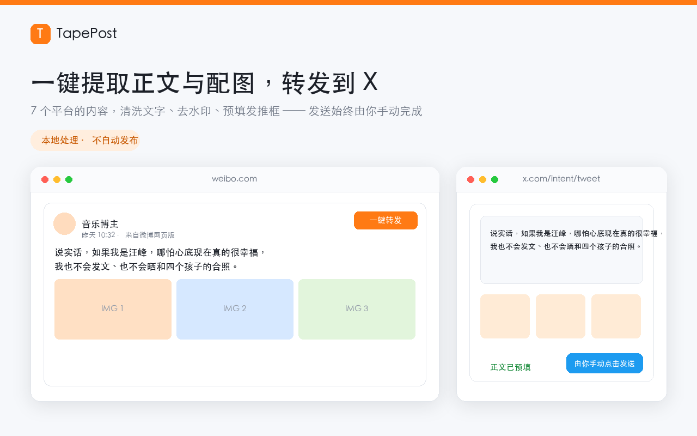

# TapePost · 一键转发到 X

> 在内容页点一下，把正文和配图整理成 X 草稿素材；在 X 上用 Grok 生成 3 条评论候选；用 295 条导航收录清单核验 TapeOut 生态链接。**发送与回复始终由你手动完成，扩展不会替你发帖。**

- 介绍页：<https://kenter1643.github.io/TapePost/>
- 隐私政策：<https://kenter1643.github.io/TapePost/privacy.html>
- 源码：<https://github.com/kenter1643/TapePost>
- 版本：1.3.1　｜　Manifest V3　｜　Chrome 116+



## 它做什么

在微博、知乎、微信公众号、B 站动态、豆瓣广播、小红书、X 的内容右上角注入一个橙色「一键转发」按钮。点击后：

1. **只取这一条**：按正文锚点定位，剥掉昵称、时间、认证标签、话题尾巴等元信息；按钮点击时实时重新解析卡片，避免无限滚动的 DOM 复用导致抓错内容。
2. **取全部配图**：九宫格、多个媒体容器、懒加载属性、CSS 背景图、内联 `pic_infos`、X 的 `name=orig` 原图，最多 9 张；自动排除头像等干扰图。
3. **本地去水印**：Canvas 先检测底部白色水印，只在命中时用包围盒插值 / BFS 重建；没检测到的图原样保留，不会强行抹图。
4. **多图托盘**：右下角弹出「干净图 N 张」，可逐张复制、拼长图、全部下载；托盘就绪后再点按钮打开 X，避免 X 抢焦点。
5. **文字预填**：清洗后的正文通过 `x.com/intent/tweet?text=...` 预填到发推框，你在 X 里粘贴图片、确认内容后**手动点发送**。

### 1.3.1 新增：AI 评论按钮移到 X 回复填写区右侧

- 紫色「AI 评论」不再挂在推文卡片右上角。先点 X 推文的「回复」展开输入框，按钮就出现在**回复填写区右侧**；时间线内联回复框与 `/compose/post` 回复弹窗都支持（此前 `/compose/` 被整页排除，回复弹窗里根本看不到按钮）。
- 选中候选后**直接写回当前回复框**：`execCommand('insertText')` 触发真实 input 事件，X 的 React 受控输入框能识别；框里已有草稿时追加一行，不覆盖。文字同时进剪贴板。
- 找不到回复框或写入被拒时，才退回原来的 `intent/tweet?in_reply_to=...` 预填页 + 剪贴板兜底。
- 回写是页面内 DOM 操作，**不新增任何网络请求**；插件仍不替你点「回复」。
- 设置面板新增可编辑「回复框选择器」（留空用内置 `div[aria-label="Post text"][role="textbox"]` 等候选），X 改版时无需升版本即可自救。
- 选择器来源：2026-11-08 在已登录 x.com 上点「回复」后的实测 DOM（`div[aria-label="Post text"][role="textbox"]`、`Replying to @xxx`、`Post your reply`、Reply 按钮）。主发推框也用 `aria-label="Post text"`，靠上下文线索排除，不会误注入。

> 注：下面 1.1.0 章节描述的「推文卡片右上角按钮 / 打开 intent 预填」是历史行为，1.3.1 起以上述新流程为准。

### 1.1.0 新增：X 一键评论（Grok 生成 3 条候选）

X 推文右上角多一个紫色「AI 评论」按钮。点击后：

- 后台把你设定的提示词 + 该条推文正文（最多 1200 字符）发给 **xAI Grok**，按提示词生成 **3 条角度不同的回复候选**；
- 右下角浮层列出 3 条，每条可「用它回复」或「复制」，也能「重新生成」；
- 选中后打开 `x.com/intent/tweet?in_reply_to=<id>&text=...` 预填回复框，文字同时进剪贴板兜底；
- **最后一步「发送」仍由你手动点**，插件不调用任何发布接口。

提示词、模型（默认 `grok-4.3`）、接口协议（Chat Completions / Responses）、接口地址都可在设置里改。**1.3.0 起没有 API Key 也能用**：自动切到「X 站内 Grok」模式，把提示词填进 x.com 的 Grok 页面并读回结果，详见下一节。

### 1.3.0 新增：非 API 模式（X 站内 Grok）

**不填 xAI API Key 也能用 Grok。** 点插件图标 →「Grok 设置」→ 运行模式：

| 模式 | 行为 | 是否需要 Key / 费用 |
| --- | --- | --- |
| 自动（默认） | 填了 Key 走官方 API，没填就用 X 站内 Grok | 无需 Key / 免费 |
| X 站内 Grok | 把提示词填进你已登录的 `x.com/i/grok`（或 X 上的 Grok 浮窗），等回答稳定后读回解析 | 无需 Key / 免费 |
| xAI API | 后台直连 `api.x.ai`，原有链路 | 需要 Key / 按量计费 |

- 扩展**不调用任何 AI 接口、不产生费用、不接触 X 登录态**；对话完全发生在 X 自己的页面里。后台优先复用「已经有 Grok 输入框」的 X 标签，没有才在后台新开一个 `/i/grok` 标签（不抢焦点）。
- 两套提示词在两种模式下共用；页面模式会把 system 指令合并进同一条消息，并额外追加「只输出最终 JSON、不要展示思考过程」的约束（实测网页版 Grok 会先吐一段思考过程）。还可写「页面模式附加要求」，并用「预览实际发送内容」查看完整文本。
- 实测选择器（2026-11-08）：输入框 `div[aria-label="Ask anything"][role="textbox"]`、发送 `button[aria-label="Send"]`、对话区 `div[aria-label="Grok"]`、回答锚点 `button[aria-label="Copy"]`。全部可在设置里改，X 改版不用升级扩展。
- **手动兜底**：关掉「自动点发送」，或直接用面板 / 评论浮层里的「复制提示词 → 自己粘贴发送 → 读取 Grok 回答」，选择器失效时照样能用。
- 需要 Chrome 已登录 `x.com` 且账号可用 Grok；X 的 Grok 有使用额度与权限限制，插件无法绕过。页面模式生成速度取决于 X，比 API 慢（默认最多等 60 秒）。

### TapeOut 生态面板（1.2.0：生态导航全量收录）

点工具栏图标里的「打开 TapeOut 生态面板」，会打开一个独立的扩展页。绿标清单来自 **TapeOut.link 生态导航收录的全部链接**，共 **295 条**，分三档：

| 档位 | 数量 | 含义 |
| --- | ---: | --- |
| 项目方官方 | 5 | 导航站带 `OFFICIAL` 标记的官方入口 |
| 生态导航收录认可 | 56 | 导航站编辑收录的第三方交易、数据、工具、社区、链游等 |
| 链上容器 · 已索引 | 234 | `web.tapeout.link` 扫描索引到的 DeWeb 容器，按官方网关精确子域比对 |

三档**都算导航认可并给绿标**，但界面明确区分等级 —— 链上容器的内容由容器所有者部署，**不代表项目方背书**。清单核验日期 2026-11-08，内置在 `grok.js` 的 GENERATED 区块里。

- **链接真伪查询**：粘贴任意链接 → 本地清单先精确比对 → Grok 按设定提示词结合本地权威结论给出解释与仿冒风险（形近域名、Punycode、短链、非 HTTPS、第三方网关）；
- **防伪底线**：结论以本地清单为准，Grok 不能把清单外的链接判成认可平台；两者冲突会在界面标红提示。即使 Grok 不可用，本地判定依然有效；
- **安全边界**：只有 4 个独立官网域名允许「同域任意路径 / 子域」，网关域名一律精确比对；未索引的容器子域、其它 X 账号 / Telegram 群、形近域名都拿不到绿标；
- 面板提供搜索、三档筛选、一键核验与「复制 / 打开」；一次最多渲染 120 张卡片，其余用搜索定位，但**全部 295 条都参与核验**。

清单是**本地内置静态数据**，运行时不联网拉取。要刷新清单：`node tools/refresh-sites.mjs`（从 `https://tapeout.link/data/sites.js` 与 `https://web.tapeout.link/api/sites` 重新生成，断网可加 `--offline` 用缓存），然后提升扩展版本号。

> 从 1.1.0 升级且手动改过「核验提示词」的用户，请在设置里点一次「恢复默认核验提示词」，新版提示词会带上 `{LOCAL_RESULT}` 本地权威结论占位符。

## 支持的站点

| 站点 | 正文 | 配图 | 备注 |
| --- | --- | --- | --- |
| 微博 | 支持 | 九宫格 | Referer 注入、底部水印检测、高清视频接口兜底 |
| 知乎 | 支持 | 全部内容图 | zhimg.com 图床 |
| 微信公众号 | 支持 | 全部内容图 | qpic.cn 图床 |
| B 站动态 | 支持 | 全部内容图 | hdslb.com / bfsstatic.com |
| 豆瓣广播 | 支持 | 全部内容图 | doubanio.com |
| 小红书 | 支持 | 全部内容图 | 图片地址带时效签名，失败请刷新重试 |
| X / Twitter | 支持 | 原图参数升级 | `article[data-testid="tweet"]`，发布/登录/注册页不注入；另有「AI 评论」 |

每个站点都有独立的选择器、图床域名、Referer 与水印策略，并可在设置里逐个开关；未配置的网站不会注入任何界面。

## 安装

**Chrome 网上应用店**：1.3.1 已打包完成，首次上架需要开发者本人在 [Developer Dashboard](https://chrome.google.com/webstore/devconsole) 完成注册并创建条目，见 `store/listing.json`。

**本地加载（开发者模式）**

1. 克隆本仓库：`git clone https://github.com/kenter1643/TapePost.git`
2. 打开 `chrome://extensions`，打开右上角「开发者模式」
3. 点「加载已解压的扩展程序」，选择**仓库根目录**（`manifest.json` 所在目录）
4. 打开任一支持的站点，内容右上角出现「一键转发」即可使用
5. 要用 AI 评论 / 链接核验：默认「自动」模式，没填 API Key 就用已登录的 X 站内 Grok（免费）；想走官方 API 才在「Grok 设置 → API 模式专属设置」填 Key 并点「测试当前模式」

商店提交包 `store/TapePost_1.3.1_store.zip` 随仓库分发，也可在[介绍页](https://kenter1643.github.io/TapePost/)直接下载（介绍页附带副本 `docs/assets/TapePost_1.3.1_store.zip`）。解压后在 `chrome://extensions` 以开发者模式加载即可。自行重新打包：

```bash
zip -q store/TapePost_1.3.1_store.zip \
  manifest.json account.js sites.js grok.js background.js content.js inpaint.js \
  offscreen.html offscreen.js popup.html popup.js panel.html panel.js \
  icons/icon16.png icons/icon32.png icons/icon48.png icons/icon128.png
```

## 设置

点工具栏图标打开设置面板：

- **转发**：图片去水印（默认开）、视频取原片、正文 `#` 话题的三种处理方式、附原推链接、附个人署名、X 域名、7 个站点开关；
- **Grok**：运行模式（自动 / X 站内 Grok / xAI API）、两套可编辑提示词 + 页面模式附加要求 + 「预览实际发送内容」、页面选择器与自动发送/新建对话开关、打开 Grok 页面；API 模式专属：xAI API Key、接口协议、模型 ID、接口地址、测试连接、允许自定义网关域名；
- **工具**：「🔍 运行环境自检」（Service Worker / DNR 规则 / 离屏文档状态）、「打开 TapeOut 生态面板」。

密钥与接口配置只存 `chrome.storage.local`（本机、不同步、不入库）；模式、页面选择器、偏好与提示词存 `chrome.storage.sync`。提示词留空＝用 `grok.js` 内置默认；删掉 `{POST}` / `{LOCAL_RESULT}` / `{OFFICIAL_LIST}` / `{URL}` 占位符时，插件会自动把对应内容补到提示词末尾。

插件内置的 X 账号与社区身份在 `account.js`；改名或换号只改这一处。

## 目录结构

```
.
├── manifest.json          # MV3 清单（权限 / 主机权限 / content scripts）
├── account.js             # 内置账号与社区身份（单一来源）
├── sites.js               # 7 个站点的配置表与 detectSite()
├── grok.js                # 295 条收录清单、URL 防伪判定、提示词、模式路由与结果解析（共享层）
├── grok-page.js           # 注入 x.com 的页面模式桥接：填提示词 / 点发送 / 读回答
├── content.js             # 按钮注入、正文/配图提取、多图托盘、X 评论候选浮层
├── background.js          # Service Worker：DNR 规则、消息路由、Grok 双模式客户端、下载
├── offscreen.html/js      # 离屏文档：Canvas 去水印、剪贴板写入、视频地址解析
├── inpaint.js             # 纯 JS 水印检测与重建
├── popup.html/js          # 设置面板（转发 / Grok / 面板入口）
├── panel.html/js          # TapeOut 生态面板（绿标清单 + 链接真伪查询）
├── test-harness.js        # Node 端到端回归（无需浏览器）
├── tools/refresh-sites.mjs # 从导航站公开数据重新生成收录清单
├── docs/                  # GitHub Pages：介绍页 + 隐私政策 + 静态资源
└── store/                 # 上架素材：listing.json、截图、宣传图、上传脚本
```

## 开发与测试

```bash
node test-harness.js                  # 130 个场景：转发链路 + 全量清单防伪 + 分级判定 + 回复框按钮注入/候选回写 + 非 API 页面模式端到端
WBX_VERBOSE=1 node test-harness.js   # 打印详细流水
```

改动 `content.js` 后记得在 `chrome://extensions` 点刷新，并刷新来源站页面；扩展有「上下文已失效」提示时按提示刷新即可。

## 上架 Chrome Web Store

`store/listing.json` 里已备好名称、摘要、详细描述、分类、单一用途、逐项权限理由、数据使用披露、审核员验证步骤与提交清单；`store/upload.mjs` 用官方 API v2 做后续版本的上传 / 查状态 / 发布（凭证只从环境变量读取，不落盘）。

注意：Chrome Web Store API v2 **没有新建条目接口**，首个版本必须由开发者本人在 Dashboard 点「Add new item」上传 zip 创建条目，拿到 `ITEM_ID` / `PUBLISHER_ID` 并配置 OAuth 后，脚本才能更新后续版本。当前版本的数据使用披露里 `transmits_data_off_device` 已改为 `true`：AI 功能会把用户点选的文字/链接发送给 xAI，提交表单时务必如实勾选。

## 隐私

**转发链路纯本地**：无自有服务器、无账号、无遥测、无远程代码。所有提取、去水印、剪贴板写入与下载都发生在本机。

**转发全链路纯本地**。**AI 功能分两种模式**：① `api` 模式：只有你主动点「AI 评论」/「核验链接」并填了自己的 Key，扩展才把推文正文或待核验链接（连同本地结论、清单摘要、提示词）发给 `api.x.ai` 或自填网关；② `page` 模式（免 Key）：扩展**不向任何 AI 服务发请求**，只把提示词填进你已登录的 X 站内 Grok 页面、由 X 完成对话，再读取该页回答文本在本机解析 —— 这段对话受 X 的条款与隐私政策约束。两种模式都不发送浏览历史、Cookie、登录态、图片文件或其它标签页内容；插件也不读取或存储 X 的登录凭据。

完整说明见 [隐私政策](https://kenter1643.github.io/TapePost/privacy.html)（源码 `docs/privacy.html`）。

## 已知边界

- X 视频通常是 HLS / blob 流，暂不能导出干净 mp4；其它站点只能取页面里出现的图片 / 视频直链。
- 各站水印样式不同，检测不到时一律原图保留，不会强行抹图。
- AI 功能默认不需要 Key：走 X 站内 Grok 页面模式（需登录 X 且账号可用 Grok）；若要走官方 API，才需自备 xAI Key 与可用网络，国内直连 `api.x.ai` 可能失败，需代理或兼容网关。API 调用费用由你承担。
- 页面模式依赖 X 网页版 Grok 的 DOM 结构（输入框 / 发送按钮 / 回答复制按钮）。X 改版可能导致自动填词或读取失效：设置里所有选择器都可编辑，另有「复制提示词 → 自己粘贴发送 → 读取 Grok 回答」的手动兜底，不会静默失败。网页版 Grok 会输出思考过程且不一定严守 JSON 格式，插件已做宽松 JSON 提取，解析失败会在界面明确提示。
- 官方清单是 2026-11-08 从 TapeOut.link 抓取的静态快照，官方后续增删条目需手动更新 `grok.js`；Grok 的核验结论仅供参考，访问链上平台前请再次核对地址。
- 需要你已登录 X；商店截图目前是功能示意图，正式上架建议替换为真机截图。

转载他人内容前请确认授权，建议开启「附原推链接」标注来源。TapePost 与 X、xAI、TapeOut 官方及上述任何站点均无官方关联，绿标清单不构成背书或投资建议。

## 许可

[MIT](LICENSE) © 2026 TapeOut Community
